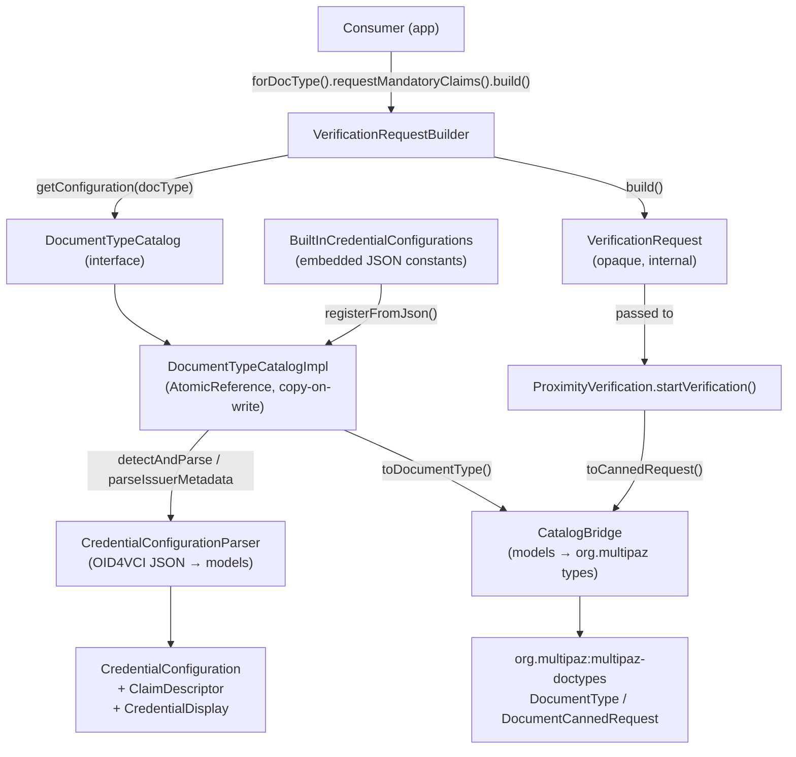
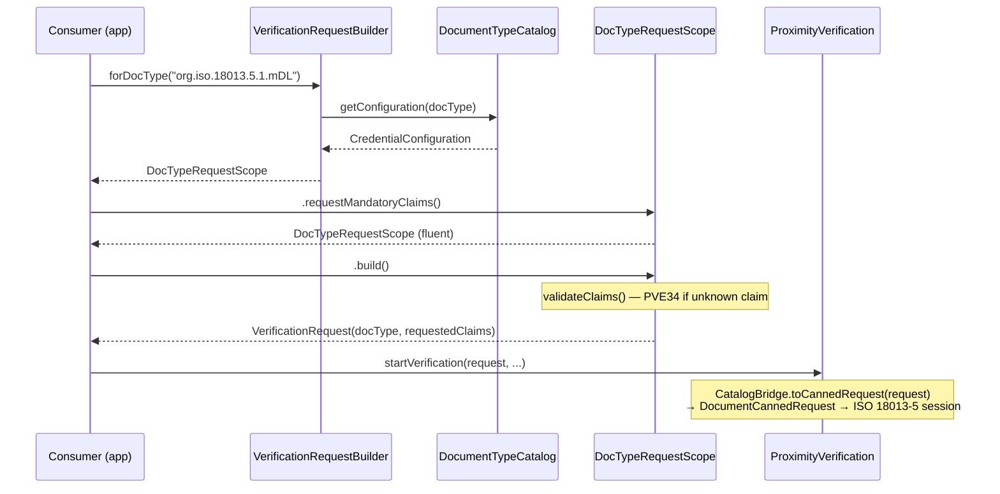

# catalog

The `catalog` component manages the registry of known mso_mdoc credential configurations (document types) and provides the consumer-facing `VerificationRequestBuilder` API for composing field-level document requests. It bridges catalog models to the underlying `org.multipaz` identity-credential library via `CatalogBridge`.

## Responsibility

**Owns:**
- `DocumentTypeCatalog` registry — registration, lookup, and lifecycle of `CredentialConfiguration` entries
- JSON parsing of OID4VCI credential configuration shapes (single config or full issuer metadata)
- Remote issuer metadata fetching (`/.well-known/openid-credential-issuer`)
- Built-in configurations for Italian mDL and Wallet Attestation
- `VerificationRequestBuilder` — the only consumer-facing API for building `VerificationRequest`
- Translation of catalog models to `org.multipaz` types (`CatalogBridge`)

**Does NOT own:**
- `VerificationRequest` execution (owned by `core-api` / `ProximityVerification`)
- CBOR encoding or ISO/IEC 18013-5 protocol framing (owned by `transport` / `multipaz`)
- Credential presentation or holder-side logic
- Document response parsing (`core/models/document/`)

## Architecture



## Key Files

| File | Notable entry points |
|---|---|
| `DocumentTypeCatalog.kt` | `DocumentTypeCatalog` interface — `registerFromJson()`, `registerFromIssuerMetadata()`, `getConfiguration()`, `isRegistered()` |
| `DocumentTypeCatalogImpl.kt` | `DocumentTypeCatalogImpl.registerAll()` — lock-free copy-on-write storage via `AtomicReference<Map<String, CredentialConfiguration>>` |
| `VerificationRequestBuilder.kt` | `VerificationRequestBuilder.forDocType()`, `DocTypeRequestScope.requestMandatoryClaims()`, `DocTypeRequestScope.build()` |
| `CredentialConfigurationParser.kt` | `CredentialConfigurationParser.detectAndParse()`, `parseSingle()`, `parseIssuerMetadata()`; `parseClaims()` applies `distinctBy { ns to identifier }` — deduplicates claims at parse time so malformed issuer metadata with repeated `(namespace, identifier)` pairs cannot produce duplicate `ClaimDescriptor` entries |
| `CatalogBridge.kt` | `CatalogBridge.toDocumentType()`, `CatalogBridge.toCannedRequest()` — all `org.multipaz` references confined here |

`BuiltInCredentialConfigurations.kt` holds the embedded JSON constants `ITALIAN_DRIVING_LICENSE_JSON` and `WALLET_ATTESTATION_JSON`, loaded into the catalog at library initialization.

`CredentialConfiguration.kt` defines the data model: `CredentialConfiguration`, `ClaimDescriptor` (with `ns`, `identifier`, `isMandatory`, `dataType`), `CredentialDisplay`, `ClaimDisplay`.

## Primary Flow



## Dependencies

**Internal:**
- `core-api` — `VerificationRequest` is constructed here and consumed by `ProximityVerification.startVerification()` / `VerificationSession`
- `core/models/document/` — used downstream when parsing document responses (not owned by catalog)
- `exceptions/` — `ProximityVerificationException` with codes PVE31 (invalid JSON), PVE32 (no mso_mdoc entries), PVE33 (HTTP fetch failure), PVE34 (unknown claim), PVE35 (docType not registered)
- `network/HttpClientProvider` — Ktor HTTP client used by `registerFromIssuerMetadata()`

**External:**
- `org.multipaz:multipaz-doctypes` — `DocumentType`, `DocumentType.Builder`, `DocumentCannedRequest`, `DocumentAttributeType`; all references are isolated inside `CatalogBridge`

## Configuration

Consumers configure what document fields to request through the `VerificationRequestBuilder` fluent API:

```kotlin
// Use a built-in configuration (auto-registered at init)
val request = VerificationRequestBuilder(catalog)
    .forDocType("org.iso.18013.5.1.mDL")          // DocType identifier
    .requestMandatoryClaims()                        // or requestAllClaims() / requestNamespace(ns)
    .requestClaim("org.iso.18013.5.1", "portrait")  // or add specific elements
    .build()

// Register a custom configuration from JSON (OID4VCI single or issuer metadata format)
catalog.registerFromJson(myJsonString)

// Or fetch from an issuer's well-known endpoint
catalog.registerFromIssuerMetadata("https://issuer.example.com")
```

**DocType identifiers for built-in types:**

| Document | DocType |
|---|---|
| Italian mDL (ISO 18013-5) | `org.iso.18013.5.1.mDL` |
| Wallet Attestation | `org.iso.18013.5.1.IT.WalletAttestation` |

**Namespace identifiers:**

| Namespace | Contents |
|---|---|
| `org.iso.18013.5.1` | Core ISO mDL data elements (given_name, family_name, portrait, driving_privileges, …) |
| `org.iso.18013.5.1.IT` | Italian extensions (sub, aal, verification, document_iss_country, …) |

Claims use OID4VCI Appendix B.2 path format: `["<namespace>", "<identifier>"]`. The `intentToRetain` flag on each claim signals the verifier's intent to store the data element after verification.

## Related Documents

- [`../high-level-design.md`](../high-level-design.md)
- [`../core-api/`](../core-api/)
