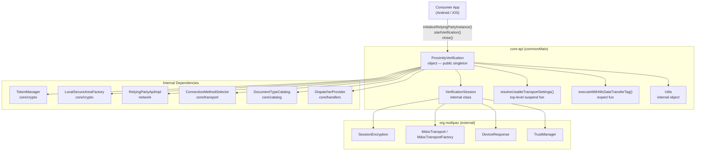
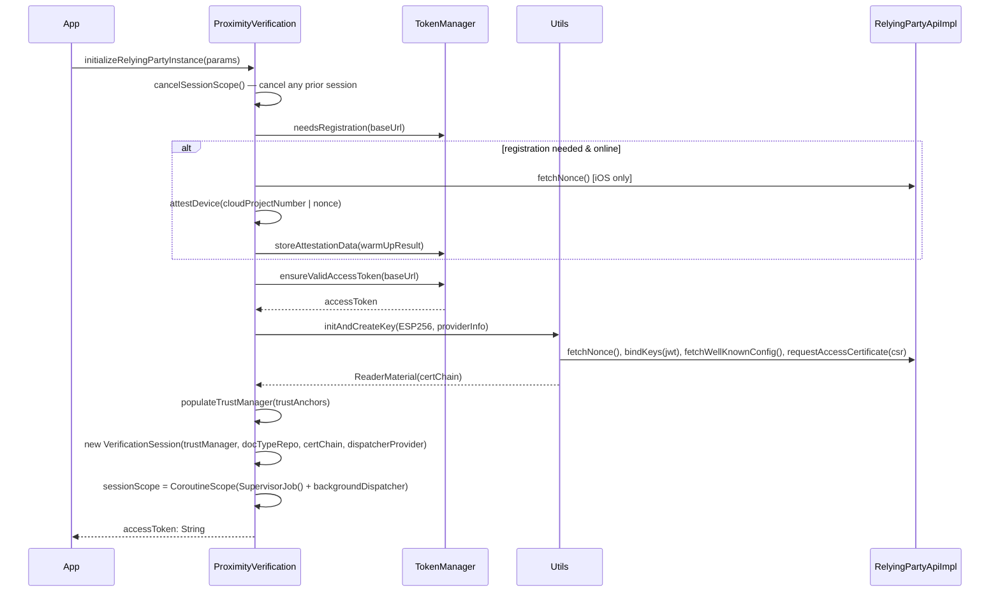
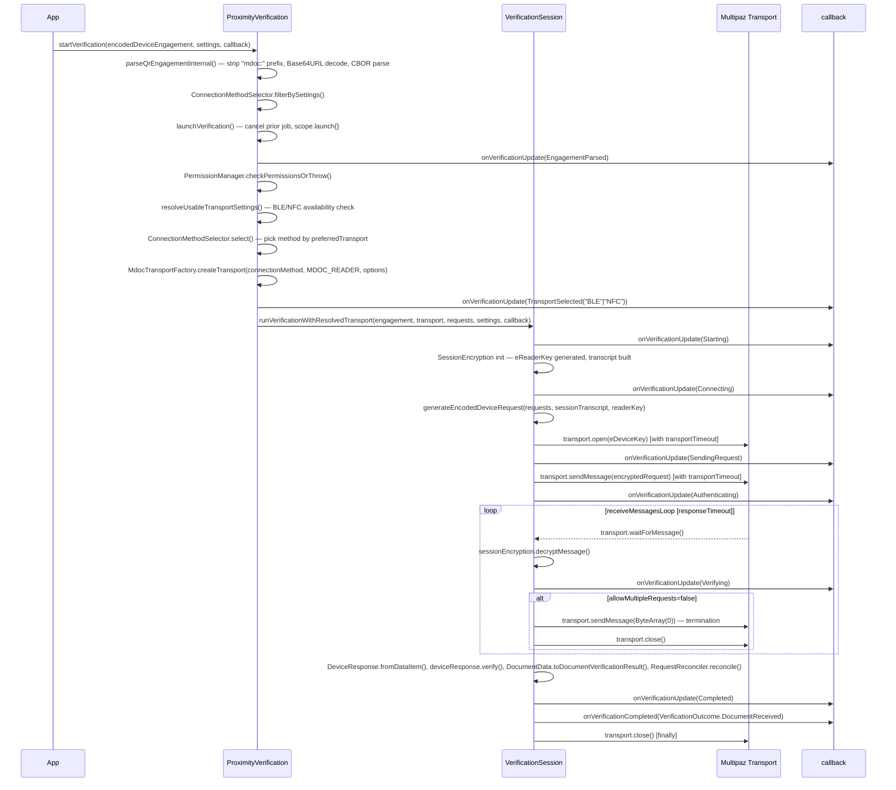

# core-api

The `core-api` component is the public entry point and orchestration engine of the `proximity-verification-ktm` library. It exposes a singleton (`ProximityVerification`) that manages reader-side session lifecycle, device attestation, and drives the ISO/IEC 18013-5 mDL verification protocol from engagement parsing through document receipt and callback dispatch.

## Responsibility

**Owns:**
- Session lifecycle: `initialize()` → active verification job → `close()`
- Device attestation and token acquisition (Android Play Integrity / iOS DeviceCheck)
- Reader key provisioning and certificate chain management via `Utils.initAndCreateKey()`
- QR and NFC engagement parsing and connection-method selection
- Verification orchestration: transport open → request encode/send → response receive/decrypt → document parse → outcome dispatch
- Callback dispatch contract (`VerificationCallback`) and step sequencing (`VerificationStep`)
- Exception taxonomy (`ProximityVerificationExceptionCode` PVE00–PVE41) and mapping to `VerificationOutcome.ProtocolFailed`
- Federation registry resolution kick-off at init (`RegistryResolver.resolve(...)` → populates `documentTypeCatalog`, persists `ResolvedRegistryData`)
- Public toggle API for offline verification: `enableStatusListsForOfflineUse` (orchestrates **status list + CRL** prefetch in one call; the call name is preserved for back-compat), `disableStatusListsForOfflineUse` (clears both stores), `isStatusListsForOfflineUseEnabled`, `clearLibraryLocalStorage` (clears both `PROX_VER_STATUS_LIST_CACHE` and `PROX_VER_CRL_CACHE`)
- Public read-side cache projection API: `getOfflineCacheSnapshot(): OfflineCacheSnapshot` — single suspend method aggregating status list and CRL caches. Friendly pre-init: returns empty snapshot with `offlineEnabled = false` instead of throwing

**Does NOT own:**
- Transport protocol implementation (BLE/NFC wire-level — delegated to `org.multipaz:multipaz`)
- Network HTTP client (`RelyingPartyApiImpl` in the `network` component)
- Cryptographic key storage (`TokenManager`, `LocalSecureAreaFactory` in `core/crypto`)
- Document type catalog registration (`DocumentTypeCatalog` in `core/catalog`)
- Platform NFC tag scanning UI (Android `NfcPromptBinding`, iOS CoreNFC — platform-specific `expect/actual`)
- `DispatcherProvider` platform implementations (`androidMain` / `iosArm64Main`)

## Architecture



## Key Files

| File | Key entry point(s) |
|------|--------------------|
| `proximityverification/src/commonMain/kotlin/it/infocert/proximityverification/ProximityVerification.kt` | `initializeRelyingPartyInstance()`, `startVerification()`, `launchVerification()`, `executeVerificationFlow()`, `close()` |
| `proximityverification/src/commonMain/kotlin/it/infocert/proximityverification/VerificationSession.kt` | `runVerificationWithResolvedTransport()`, `resolveUsableTransportSettings()`, `receiveMessagesLoop()`, `executeTransportOperationWithTimeout()` |
| `proximityverification/src/commonMain/kotlin/it/infocert/proximityverification/Utils.kt` | `Utils.initAndCreateKey()`, `Utils.generateEncodedDeviceRequest()`, `Utils.generateEncodedSessionTranscript()`, `Utils.populateTrustManager()` |
| `proximityverification/src/commonMain/kotlin/it/infocert/proximityverification/callback/VerificationCallback.kt` | `VerificationCallback` interface |
| `proximityverification/src/commonMain/kotlin/it/infocert/proximityverification/lifecycle/VerificationStep.kt` | `VerificationStep` sealed class |
| `proximityverification/src/commonMain/kotlin/it/infocert/proximityverification/exceptions/ProximityVerificationExceptionCode.kt` | Full PVE code taxonomy (PVE00–PVE41) |
| `proximityverification/src/commonMain/kotlin/it/infocert/proximityverification/NfcDataTransfer.kt` | `executeWithNfcDataTransferTag()` expect declaration |
| `proximityverification/src/commonMain/kotlin/it/infocert/proximityverification/VerificationSessionLog.kt` | `logRequests()`, `logResponse()`, `logRequestOutcome()` — shape-of-session diagnostics, facts only |
| `proximityverification/src/commonMain/kotlin/it/infocert/proximityverification/core/models/request/RequestOutcome.kt` | `RequestOutcome`, `DocumentRequestOutcome`, `DocumentRequestStatus`, `ClaimOutcome`, `ClaimStatus` |
| `proximityverification/src/commonMain/kotlin/it/infocert/proximityverification/core/reconciliation/RequestReconciler.kt` | `RequestReconciler.reconcile()`, `ReturnedDocumentFacts.from()` (internal) |

## Key Interfaces / Types

### `ProximityVerification` (object) — `ProximityVerification.kt:58`
Public singleton. Manages one session at a time (`verificationSession`, `sessionScope` backed by `SupervisorJob() + backgroundDispatcher`). Exposes:
- `initializeRelyingPartyInstance(params)` — bootstraps attestation, token, reader key, session scope, **and runs `RegistryResolver.resolve(...)` to populate the catalog from federation metadata**
- `initializeStandalone(params: StandaloneRelyingPartyParams = StandaloneRelyingPartyParams())` — **test-only / no-backend init**. Self-signed reader key (`PROX_VER_STANDALONE_INIT_KEY`), optional catalog from OID4VCI JSON/URL, optional trust-all (null trustAnchors). No attestation, no token, no federation registry contact. `enableStatusListsForOfflineUse()` will throw PVE01 on a standalone session. A subsequent `initializeRelyingPartyInstance()` call overwrites cleanly
- `startVerification(encodedDeviceEngagement, settings, callback, platformContext?)` — QR entry point
- `startVerificationWithNfc(settings, callback, activity?)` — NFC entry point (`expect`)
- `enableStatusListsForOfflineUse(docTypes)` / `disableStatusListsForOfflineUse()` / `isStatusListsForOfflineUseEnabled()` — orchestrates Token Status List **and CRL** prefetch + toggle (see `status/` and `crypto/` components). Returns `StatusListPrefetchSummary.crlSummary` non-null on successful CRL prefetch, `null` if a CRL prefetch throw was absorbed (offline flag still flips on). `enableStatusListsForOfflineUse` runs a connectivity pre-check (`NativeUtils.isNetworkAvailable()`) right after the `PVE01` initialization check and before any federation pre-check (`PVE37`/`PVE38`), prefetch call, or store write — when the device is offline it throws `ProximityVerificationException(PVE40)` immediately and leaves persisted state untouched (consumer responsible for retry). **Direct-federation fallback (v0.6.5):** when `resolvedRegistryData` is null but `sessionAllowedIssuerIds` is non-empty, the method resolves each issuer directly via federation and builds a synthetic `ResolvedRegistryData`; throws `PVE37` only when both registry and direct-federation paths are unavailable
- `getOfflineCacheSnapshot(): OfflineCacheSnapshot` — public suspend, returns a structured projection of both caches with computed fields (`usability`, `expiresAtEpochSeconds`, `isStale`) and persisted issuer context. Safe to call before `initializeRelyingPartyInstance`: returns empty snapshot with `offlineEnabled = false`. Errors degrade to empty (never throw, except `CancellationException` re-thrown)
- `getReaderCertificate(): ReaderCertificateInfo?` — read-only projection of the reader/access certificate obtained from the verifier backend (subject/issuer, validity, serial, SHA-256 fingerprint, PEM). Re-reads the chain from the SecureArea; returns `null` when not registered
- `close()` — cancels all jobs and nulls session state
- `documentTypeCatalog` — pre-populated with Italian DL and Wallet Attestation types, then enriched by registry-resolved configurations

### `VerificationCallback` — `callback/VerificationCallback.kt:6`
```kotlin
interface VerificationCallback {
    fun onVerificationUpdate(step: VerificationStep)
    fun onVerificationCompleted(outcome: VerificationOutcome)
}
```
All calls are dispatched on `DispatcherProvider.callbackDispatcher`.

### `VerificationOutcome` (sealed class) — `core/models/VerificationOutcome.kt:6`
| Subtype | Meaning |
|---------|---------|
| `DocumentReceived(sessionInfo, documents, requestOutcome)` | Happy path — parsed documents, timing metadata, and the inventory of what was requested versus what the wallet returned |
| `ProtocolFailed(reason, message)` | Any failure — `reason` maps to a `ProtocolFailureReason` derived from a PVE code |

Note that `DocumentReceived` is also the outcome when the wallet returns **no** document — an empty
response, or one carrying only a non-`0` `status`, is not reported as a protocol failure. Read
`sessionInfo.deviceResponseStatus` to tell a wallet-side abort from a wallet that simply held
everything back. A `status` of `10` (ISO general error) with zero documents most often means the wallet
does not trust the reader CA: it accepts and parses the request, shows the consent screen, then aborts
with a code that carries no reason. The reader cannot distinguish that from any other refusal — see
[INTEGRATION_GUIDE](../INTEGRATION_GUIDE.md) § Verification Outcome.

### `RequestOutcome` — `core/models/request/RequestOutcome.kt`
Inventory carried by `DocumentReceived`: one `DocumentRequestOutcome` per requested docType
(`RETURNED` / `DENIED` / `ABSENT`, plus the raw `documentErrors` code), each holding a `ClaimOutcome`
per claim (`RETURNED` / `WITHHELD` / `ABSENT` / `UNREQUESTED`, plus the raw `errors` code).

Purely additive: it never affects whether a verification succeeded, and the SDK emits no verdict on
it. ISO/IEC 18013-5 cannot make a claim mandatory — a request is a wish-list whose only per-element
modifier, `IntentToRetain`, is a statement by the reader, and a response may legitimately be partial
— so requiring claims is a policy the consumer applies on these facts.

Built by `RequestReconciler`, which compares the request against the issuer-signed data elements
actually present rather than merely echoing the wallet's `errors`/`documentErrors` maps: populating
those is optional for the wallet, so a silent omission — the common case in the field — would
otherwise be invisible.

**Base a mandatory-claim decision on `RETURNED` versus not-`RETURNED`, never on the `WITHHELD` /
`ABSENT` difference.** No signature covers the error maps: the MSO signs the digests of the elements
that *are present*, and `deviceAuth` covers `SessionTranscript`, `docType` and
`DeviceNameSpacesBytes`. A device-signed element is reported `ABSENT`, since the SDK does not surface
those in `DocumentVerificationResult.data`.

The field is `ClaimOutcome.nameSpace`, spelled as in the ISO/IEC 18013-5 CDDL: `namespace` would be
exported to Objective-C as `namespace_`, since the generated header may be included from
Objective-C++ where it is a keyword, leaving every iOS consumer with a mangled name.

### DeviceResponse integrity — `VerificationSession.kt:verifyDeviceResponseDocuments()`
Returns the internal `VerifiedDeviceResponse` (verified `MdocDocument`s **plus** the typed
`documentErrors`, read once from `DeviceResponse` instead of being re-dug out of the raw CBOR by each
internal consumer).

multipaz's `DeviceResponse.verify()` is all-or-nothing: it raises `IllegalStateException` both for
integrity failures (MSO signature, docType mismatch, digest, `deviceAuth`) and for an out-of-window
MSO. The aggregate call is kept as a **fast path** — the nominal case behaves exactly as before — and
only on failure does each document get re-verified in isolation, on a single-document response rebuilt
from the raw `DataItem` (the signatures are per-document, so extracting one invalidates nothing), with
`atTime` clamped inside that document's MSO window. Integrity causes still yield `PVE04`; the window is
re-evaluated outcome-side by `MsoValidityChecker` against the real clock, which makes
`MSO_VALIDITY = FAILED` reachable instead of collapsing into a protocol error.

**Fail-closed** on what the loop cannot isolate: if the response also carries `zkDocuments`,
`encryptedDocuments` or `otherDocuments`, the result stays `PVE04` — verifying only the mdocs would
turn a response containing something unverified into a valid one. (`otherDocuments` is looked up in the
raw CBOR because multipaz 0.99.0 does not model it at all.)

### `VerificationStep` (sealed class) — `lifecycle/VerificationStep.kt:3`
Ordered steps emitted via `onVerificationUpdate()`:

**NFC engagement path:** `NfcScanningStarted` → `NfcTagDetected` → `NfcEngagementReading` → `NfcEngagementCompleted`

**Common path (both QR and NFC):** `EngagementParsed` → `TransportSelected` → [`NfcDataTransferReady`] → `Starting` → `Connecting` → `SendingRequest` → `Authenticating` → `Verifying` → `Completed` | `Failed`

### `DispatcherProvider` — `core/handlers/DispatcherProvider.kt:16`
```kotlin
interface DispatcherProvider {
    val defaultDispatcher: CoroutineDispatcher   // CPU-bound
    val backgroundDispatcher: CoroutineDispatcher // IO/network (Android: IO, iOS: Default)
    val callbackDispatcher: CoroutineDispatcher  // callback delivery
}
```
Session scope: `SupervisorJob() + backgroundDispatcher` (see `ProximityVerification.kt:266`).
Override via `ProximityVerification.configureDispatcherProvider()`.

### `StandaloneRelyingPartyParams` — `StandaloneRelyingPartyParams.kt`
`data class` params for `initializeStandalone`. `trustAnchors: List<String>?` (null = trust-all; PEM strings otherwise). `issuerMetadata: StandaloneIssuerMetadata?` (null = built-in mDL ISO 18013-5 catalog).

### `StandaloneIssuerMetadata` — `StandaloneRelyingPartyParams.kt`
Sealed class controlling OID4VCI catalog source in standalone init:
- `FromJson(json: String)` — parses `credential_configurations_supported` from the provided JSON string (zero network calls)
- `FromUrl(url: String)` — SDK fetches `{url}/.well-known/openid-credential-issuer` at init time (requires network access to the issuer, not to the RP backend)

### `VerificationRequest` — `VerificationRequest.kt:9`
Opaque value object (constructed via `VerificationRequestBuilder`). Carries `docType: String` and `requestedClaims: Map<namespace, Map<identifier, intentToRetain>>`. Passed as a list in `ProximityVerificationSettings.requests`.

### `ProximityVerificationSettings` — `core/models/initialization/ProximityVerificationSettings.kt:38`
Immutable data class (with `Builder`). Key fields for session behavior:

| Field | Default | Effect |
|-------|---------|--------|
| `requests` | — | Required; empty list is rejected immediately |
| `preferredTransport` | `AUTO` | Selects BLE vs NFC when both available |
| `transportTimeout` | 30 s | Applied to `transport.open()` and `transport.sendMessage()` |
| `responseTimeout` | 300 s | Applied to the full `receiveMessagesLoop()` |
| `allowMultipleRequests` | `false` | `false` → auto-close after first response |
| `bleUseL2CAP` | `false` | Passed to `MdocTransportOptions` |
| `nfcDataTransferEnabled` | `true` | Enables QR→NFC data transfer fallback |

## Flows

### Initialization flow



### QR verification flow



## Configuration

### `DispatcherProvider`
Injected at `initialize()` time and propagated to `VerificationSession`. Can be overridden any time via `ProximityVerification.configureDispatcherProvider(provider)`, which also hot-updates an active session. Reset to platform default on `close()`.

- `backgroundDispatcher` — used for the session `CoroutineScope`; all heavy work runs here
- `callbackDispatcher` — all `onVerificationUpdate` / `onVerificationCompleted` calls are dispatched here via `withContext(dispatcherProvider.callbackDispatcher)`
- If the callbackDispatcher does not need dispatch (`isDispatchNeeded` returns false), the synchronous path is taken in `dispatchProtocolFailureOnCallbackDispatcher()`

### `ProximityVerificationSettings` timeout fields
`transportTimeout` (default 30 s) gates `transport.open()` and `transport.sendMessage()` via `executeTransportOperationWithTimeout()`. `responseTimeout` (default 300 s) wraps the entire `receiveMessagesLoop()` via `withTimeoutOrNull()`. On timeout, the session sends a zero-byte termination character before throwing PVE30.

## Dependencies

### Internal
| Dependency | Purpose |
|------------|---------|
| `network.RelyingPartyApiImpl` | Nonce fetch, key binding, well-known config, access certificate, token management |
| `core/crypto.TokenManager` | OAuth token storage, registration detection, access token refresh |
| `core/crypto.LocalSecureAreaFactory` | Hardware-backed key creation (Android Keystore / iOS Secure Enclave) |
| `core/crypto.IntegrityWarmupManager` | Platform integrity attestation (Play Integrity / DeviceCheck) |
| `core/transport.ConnectionMethodSelector` | Filters and selects `MdocConnectionMethod` based on settings |
| `core/catalog.DocumentTypeCatalog` + `CatalogBridge` | Registered document types → `DocumentTypeRepository` entries and canned requests |
| `core/handlers.PermissionManager` | BLE/NFC permission checks before verification starts |

### External
| Dependency | Purpose |
|------------|---------|
| `org.multipaz:multipaz` (v0.96.0) | Full ISO 18013-5 protocol stack: `SessionEncryption`, `MdocTransport`, `DeviceEngagement`, `DeviceResponse`, `TrustManager`, `MdocTransportFactory` |
| Android NFC (`NfcAdapter`, HCE) | Platform NFC tag scanning — `androidMain` `actual` for `executeWithNfcDataTransferTag` |
| iOS CoreNFC | Platform NFC tag reading — `iosArm64Main` `actual` for `executeWithNfcDataTransferTag` and `startVerificationWithNfc` |

## Error Handling

**Exception hierarchy:**
- `ProximityVerificationException(message, cause?, code)` — base; always carries a PVE code
- `VerificationException` — subclass used inside the verification flow (`VerificationSession.kt`)

**PVE codes relevant to session lifecycle:**

| Code | Meaning | Where thrown |
|------|---------|--------------|
| PVE01 | Init/key creation failure | `initAndCreateKey()`, cert parsing |
| PVE03 | Crypto/trust-manager failure | `populateTrustManager()`, JWT verify |
| PVE04 | Device response integrity failure | `DeviceResponse.verify()` |
| PVE05 | Invalid parameters | `initializeInternal()` blank baseUrl, attestation |
| PVE07 | Generic verification failure | transport errors, missing session, empty requests |
| PVE08 | REST API error | token/nonce/cert fetch failures |
| PVE09 | Bluetooth unavailable | `resolveUsableTransportSettings()` |
| PVE13 | Attestation not executed | `attestDevice()` offline without cached tag |
| PVE24 / PVE25 | NFC hardware absent / NFC disabled | `resolveUsableTransportSettings()` |
| PVE28 | Invalid QR engagement data | `parseQrEngagementInternal()` |
| PVE30 | Transport operation timeout | `executeTransportOperationWithTimeout()` / receive timeout |
| PVE36 | mDL session termination without DeviceResponse | `VerificationSession` — device closed communication before sending a usable response |
| PVE37 | No `status_list_aggregation_endpoint` in resolved registry for the requested docTypes | `enableStatusListsForOfflineUse()` |
| PVE38 | Status list prefetch requested an unknown docType | `enableStatusListsForOfflineUse()` |
| PVE39 | Status list cache I/O error class (umbrella) | `status/` cache failures (today surfaced per-uri in `failedLists` as `STORAGE_ERROR`) |
| PVE40 | `OFFLINE ENABLE REQUIRES NETWORK CONNECTIVITY` — device offline at the time of `enableStatusListsForOfflineUse()` | Thrown by the connectivity pre-check inside `enableStatusListsForOfflineUse()`, before any federation pre-check (`PVE37`/`PVE38`), prefetch call, or store write. Persisted state is left untouched; consumer must retry when connectivity returns |
| PVE41 | `NO COMPATIBLE CONNECTION METHOD BETWEEN WALLET AND READER` — no connection method in the mDL engagement is compatible with the current transport settings | `ConnectionMethodSelector.requireNonEmpty()` — thrown when `filterBySettings()` returns an empty list (e.g. mDL offers only BLE peripheral but the reader has BLE disabled; or engagement lists only methods not supported on this platform) |

**`CancellationException` rule:** All `catch (e: Exception)` blocks in `initializeInternal()`, `attestDevice()`, `runVerificationWithResolvedTransport()`, and `clearLibraryLocalStorage()` explicitly re-throw `CancellationException` before any domain conversion. It is never wrapped into a PVE or passed to `onVerificationCompleted()`.

**Outcome mapping:** `ProximityVerification.mapExceptionToOutcome(error)` converts any `ProximityVerificationException` into `VerificationOutcome.ProtocolFailed(reason, message)` via `ProtocolFailureReason.fromCode(error.code)`. This is the only path to `ProtocolFailed`; the function is `internal` and called exclusively from `launchVerification()` and `dispatchProtocolFailureOnCallbackDispatcher()`.

**Session lifecycle on error:**
- Errors inside `runVerificationWithResolvedTransport()` dispatch `VerificationStep.Failed` then `onVerificationCompleted(ProtocolFailed)` before returning; the `finally` block always calls `transport.close()`.
- `MdocTransportClosedException` and `MdocTransportException` are caught separately to send a zero-byte termination character when possible.
- `launchVerification()` wraps the entire coroutine body; any uncaught `ProximityVerificationException` (or generic `Exception`) is mapped and dispatched via `callbackDispatcher`. The session scope itself (`SupervisorJob`) remains alive — only the active verification `Job` is cancelled.
- `close()` → `cancelSessionScope()` → cancels `sessionJob`, nulls `sessionScope`, `verificationSession`, and resets `dispatcherProvider`.

## Related Documents

- [High-Level Design](../high-level-design.md)
- [Catalog component](../catalog/README.md)
- [Crypto component](../crypto/README.md)
- [Network component](../network/README.md)
- [Transport component](../transport/README.md)
- [Registry component](../registry/README.md) — federation resolution chain run at init
- [Status component](../status/README.md) — Token Status List prefetch and offline-mode toggle
- [Platform Android](../platform-android/README.md)
- [Platform iOS](../platform-ios/README.md)
