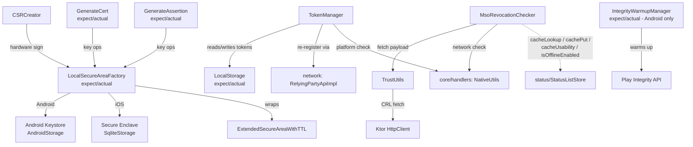
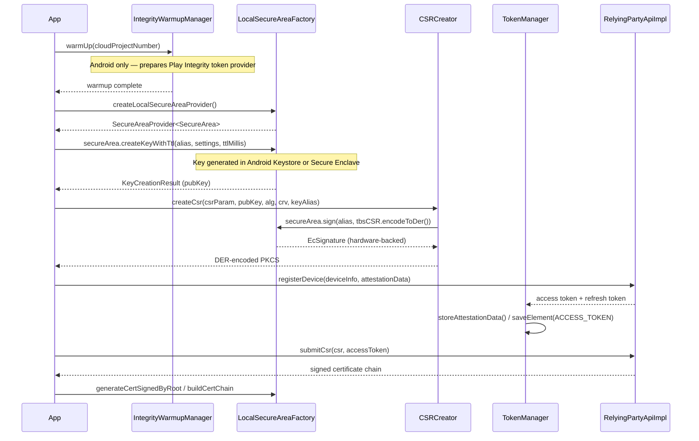
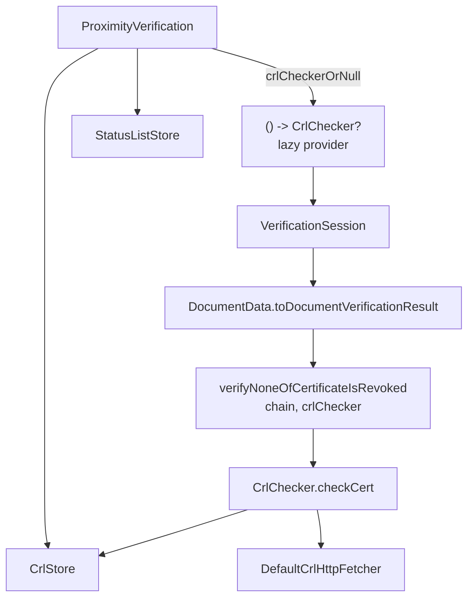

# crypto

Manages the full device key lifecycle for proximity verification: platform-secure-area abstraction (Android Keystore / iOS Secure Enclave), access/refresh token management, device attestation, CSR and certificate generation, MSO revocation checking, and X.509 trust utilities.

## Responsibility

**Owns:**
- Platform hardware key creation and signing via `LocalSecureAreaFactory` (expect/actual)
- Access token and refresh token storage, validation, and rotation (`TokenManager`)
- Device attestation warmup on Android (`IntegrityWarmupManager`, Play Integrity API)
- CSR generation and hardware-backed signing (`CSRCreator`)
- Self-signed and CA-signed certificate generation (`GenerateCert`, `GenerateAssertion`)
- MSO revocation checking against StatusList and IdentifierList endpoints (`MsoRevocationChecker`), including the cache-aware online/offline branching wired from `status/StatusListStore`
- Internal `ValidationMode` taxonomy used to label the revocation decision path for diagnostic logging
- CRL-based X.509 certificate revocation and trust chain utilities (`TrustUtils`)
- Cache-aware CRL revocation checking with explicit decision matrix (`CrlChecker`, `CrlCheckStatus`), wired into chain verification via `RevocationResult.crlCheckStatus`
- CRL persistence layer (`CrlStore`) and prefetch orchestration (`CrlPrefetcher`, `CrlHttpFetcher`, `IssuerCertChainExtractor`, `CrlMetaExtractor`) under the offline-mode toggle
- Encrypted persistent storage abstraction (`LocalStorage`, expect/actual)

**Does NOT own:**
- Network transport for registration and certificate API calls — delegated to `network/RelyingPartyApiImpl`
- ISO/IEC 18013-5 document parsing or mdoc session establishment
- BLE / NFC transport negotiation
- UI-layer permission prompting
- Token Status List downloads, freshness extraction, signing-chain trust, or persistent envelope storage — delegated to `status/` (`StatusListPrefetcher`, `StatusListStore`, `StatusListTrust`, `FreshnessExtractor`)

## Architecture

## Key Files

| File | Key entry points |
|------|-----------------|
| `core/crypto/TokenManager.kt` | `TokenManager.ensureValidAccessToken()`, `TokenManager.needsRegistration()`, `TokenManager.storeAttestationData()` |
| `core/crypto/MsoRevocationChecker.kt` | `MsoRevocationChecker.check()` — accepts `isOfflineEnabled`, `cacheLookup`, `cachePut`, `cacheUsability` lambdas wired from `status/StatusListStore`; returns `NOT_DETERMINED` when offline-with-toggle-off or on any non-cancellation error; re-throws `CancellationException` |
| `core/crypto/MsoValidityChecker.kt` | `MsoValidityChecker` — evaluates the MSO `validFrom`/`validUntil` window against the **real** clock, outcome-side. Deliberately independent of the clamp applied inside the per-document verification fallback (see `VerificationSession.verifyDeviceResponseDocuments`): that clamp neutralises only multipaz's own window check, so an expired MSO produces `MSO_VALIDITY = FAILED` here instead of collapsing into `PVE04` |
| `core/crypto/DocumentExpiryChecker.kt` | `DocumentExpiryChecker.check(expiryDateRaw, now)` — content check on the `expiry_date` claim (the credential's **administrative** expiry), distinct from the MSO's technical validity window above. Returns `null` when the claim is absent or unparsable, so a missing `expiry_date` produces no check rather than a failing one |
| `core/models/CheckMetadata.kt` | Public sealed hierarchy attached to `VerificationCheck.metadata`, additive and optional: `StatusListRevocation` (mode / usability / `RevocationState`), `CrlRevocation` (`CrlCheckStatus`), `MsoValidity`, `DocumentExpiry`. Lets a consumer see *why* a check landed where it did without the SDK issuing a verdict |
| `core/crypto/ValidationMode.kt` | Internal enum (`ONLINE_LIVE`, `ONLINE_FALLBACK_CACHE_FRESH/STALE`, `OFFLINE_CACHE_FRESH/STALE`, `OFFLINE_DISABLED_NOT_DETERMINED`) — diagnostic label for the path that produced the StatusList decision; logging-only in Phase 1 |
| `core/crypto/LocalSecureAreaFactory.kt` | `LocalSecureAreaFactory.createLocalSecureAreaProvider()` — expect/actual: Android uses `AndroidStorage` + Android Keystore; iOS uses `SqliteStorage` + Secure Enclave |
| `core/crypto/TrustUtils.kt` | `TrustUtils.isCertRevoked()` (deprecated; use `CrlChecker`), `TrustUtils.verifyNoneOfCertificateIsRevoked(chain)` (legacy public, deprecated) and the new internal overload `verifyNoneOfCertificateIsRevoked(chain, crlChecker)`; `TrustUtils.fetchRevocationPayload()`; `extractCrlDistributionPoint()` (visibility widened to `internal` for `CrlChecker` reuse) |
| `core/crypto/CrlChecker.kt` | `CrlChecker.checkCert(cert): CertCrlOutcome` — internal class implementing the cache-aware CRL decision matrix. Constructor injects `store: CrlStore?`, `isOfflineEnabled: suspend () -> Boolean`, `isOnline: suspend () -> Boolean`, `httpFetcher: CrlHttpFetcher`, `clock: () -> Long` (millis). Multi-URI fallback per cert; defensive `crl.version` access to force multipaz lazy-parse; `CancellationException` re-thrown at every catch site |
| `core/crypto/CrlCheckStatus.kt` | Public enum `VERIFIED, REFRESHED, STALE_CACHE, CACHE_MISS, FETCH_FAILED, OFFLINE_NO_DATA` ordered by **severity ordinal**; `internal fun worse(a, b): CrlCheckStatus` aggregates a chain by `if (a.ordinal >= b.ordinal) a else b`. Pinned by a pairwise truth-table test on the 36 ordered pairs |
| `crl/CrlStore.kt` | Internal class persisting `CachedCrl` envelopes under `LocalStorage` key `PROX_VER_CRL_CACHE`; mirror of `StatusListStore` semantics. API: `put(cert, uri, bytes, meta)`, `get(cert)`, `listAll()`, `decodePayload(entry)`, `isStale(entry, nowSeconds)`, `clearEntries()`. `STORAGE_KEY = "PROX_VER_CRL_CACHE"`. Computes `certKey = "${issuerDN}|${serialHex}"` with sign-byte stripping for round-trip stability |
| `crl/CrlPrefetcher.kt` | Internal orchestrator invoked by `enableStatusListsForOfflineUse`. Collects trust anchor PEMs + `x5c[0..n]` for each resolved issuer, dedups by `certKey`, downloads each CRL via `CrlHttpFetcher` (5s timeout), persists via `CrlStore.put`. Returns `CrlPrefetchSummary(certsConsidered, crlsFetched, crlsFailed, parseFailureCount, persistedAtEpochMillis)`. Multi-URI fallback per cert; certs without a CRL DP are logged at WARN and skipped (not surfaced in `crlsFailed`). Test seam: optional `crlUriLookup` parameter (default `TrustUtils::extractCrlDistributionPoint`) — see rationale.md [2026-05-09] *CrlChecker Decision Matrix* for the parser quirk that motivated the seam |
| `crl/CrlHttpFetcher.kt` | `interface CrlHttpFetcher { suspend fun fetch(uri): CrlFetchResult }` — sealed result `Success(bytes) \| Unreachable \| HttpError(code) \| Malformed`. `DefaultCrlHttpFetcher` uses `HttpClientProvider.rawClient` with per-call `timeout { … }` block (5s for request/connect/socket). Ktor exceptions classified into the sealed states; never propagate to the caller |
| `crl/IssuerCertChainExtractor.kt` | Parses `jwks.keys[0].x5c[0..n]` from `IssuerResolvedMetadata.jwks: JsonObject?`; returns `ChainExtractionResult(certificates, parseFailureCount)` covering the full chain (leaf included). Per-entry parse failures skip-and-warn; missing jwks/keys/x5c yield empty list |
| `crl/CrlMetaExtractor.kt` | `extract(payloadBytes: ByteArray): CrlMeta` — internal object reading `thisUpdate: Instant` and `nextUpdate: Instant?` from multipaz `X509Crl`. Returns `CrlMeta()` (all-null) on malformed bytes without throwing |
| `crl/model/CachedCrl.kt` | Persisted entry: `certKey, subjectDn, issuerDn, serialHex, crlUri, payloadBase64, thisUpdateEpochSeconds?, nextUpdateEpochSeconds?, fetchedAtEpochMillis` |
| `crl/model/CrlFailureReason.kt` | Public enum: `CRL_UNREACHABLE, CRL_HTTP_ERROR, CRL_MALFORMED_PAYLOAD, X5C_PARSE_ERROR, STORAGE_ERROR` |
| `offline/OfflineModeFlag.kt` | `internal object OfflineModeFlag { const val STORAGE_KEY = "PROX_VER_OFFLINE_ENABLED" }` — single source of truth for the offline-mode toggle key, shared by `StatusListStore` and `CrlStore` (toggle still owned by `StatusListStore.setEnabled(...)`) |
| `core/trust/CSRCreator.kt` | `CSRCreator.createCsr()` — builds a PKCS#10 CSR using `at.asitplus.signum:indispensable`, signs the TBS via `LocalSecureAreaFactory` |
| `core/crypto/GenerateCert.kt` | `generateSelfSignedCert()`, `generateCertSignedByRoot()`, `buildCertChain()` — expect/actual platform implementations |

## Primary Flow

Key initialization: device attestation → key generation → CSR → certificate binding.

## Dependencies

**Internal:**
- `network/RelyingPartyApiImpl` — called by `TokenManager` for `registerDevice()`, `refreshToken()`
- `core/handlers/NativeUtils` — platform detection (`isIos()`, `isAndroid()`, `isNetworkAvailable()`) used by `TokenManager`, `MsoRevocationChecker`, and `GenerateAssertion`

**External:**
- `org.multipaz:multipaz` — `SecureArea`, `SecureAreaProvider`, `SqliteStorage`, `AndroidStorage`, `RevocationStatus`, `X509Cert`, `X509CertChain`
- `at.asitplus.signum:indispensable` — `CryptoPublicKey`, `CryptoSignature`, `Pkcs10CertificationRequest`, `TbsCertificationRequest`, `X509SignatureAlgorithm`
- Play Integrity API (`com.google.android.play.core.integrity`) — Android-only, wrapped by `IntegrityWarmupManager`
- iOS Secure Enclave — accessed via multipaz's `LocalSecureArea` in the `iosArm64Main` actual
- Ktor `HttpClient` — raw byte fetches in `TrustUtils` (CRL and revocation payloads)

## Configuration

Crypto-relevant fields come from `RelyingPartyProviderInfo` (wrapped by `RelyingPartyInstanceParams`):

| Field | Type | Purpose |
|-------|------|---------|
| `baseUrl` | `String` | Backend URL stored by `TokenManager` to detect URL changes and trigger re-registration |
| `csrParam` | `CSRParam` | CN / O / OU / C fields encoded into the PKCS#10 CSR by `CSRCreator` |
| `deviceInfo` | `DeviceInfo` | Sent to `registerDevice()` and cached by `TokenManager` for re-registration |
| `trustAnchors` | `List<String>` | Base64-encoded PEM certs loaded via `TrustUtils.loadPemCert()` for chain validation |
| `cloudProjectNumber` | `String?` | Android only — passed to `IntegrityWarmupManager.warmUp()` as the Play Integrity cloud project number |

`ProximityVerificationSettings` has no crypto-specific fields; it governs transport and session behavior only.

## MSO Revocation Decision Paths

`MsoRevocationChecker.checkStatusList` branches on `isOfflineEnabled()` (toggle from `StatusListStore.isEnabled`) and `isNetworkAvailable()`:

| Condition | Path | `ValidationMode` |
|-----------|------|------------------|
| Online + live fetch OK | live result wins; if toggle on, write-through cache (best-effort) | `ONLINE_LIVE` |
| Online + live fetch fails + cache hit, `Fresh` | cached payload re-validated by multipaz | `ONLINE_FALLBACK_CACHE_FRESH` |
| Online + live fetch fails + cache hit, `StaleByTtl` | cached payload re-validated; `warn` log | `ONLINE_FALLBACK_CACHE_STALE` |
| Offline + toggle on + cache hit, `Fresh` | cache-only path | `OFFLINE_CACHE_FRESH` |
| Offline + toggle on + cache hit, `StaleByTtl` | cache-only path; `warn` log | `OFFLINE_CACHE_STALE` |
| Offline + toggle off (or no cache hit) | returns `CheckStatus.NOT_DETERMINED` | `OFFLINE_DISABLED_NOT_DETERMINED` |

`Expired` is not a `Usability` value — multipaz's `StatusList.fromJwt` / `fromCwt` decide expiry at parse time when the payload's `exp` is past, raising `InvalidRequestException`.

<!-- Ingested: 2026-05-09 -->
## CRL Trust Decision Paths

`CrlChecker.checkCert` (per-cert in the trust chain) branches on `isOnline()`, `isOfflineEnabled()`, and the cached entry state. The chain-level `verifyNoneOfCertificateIsRevoked(chain, crlChecker)` aggregates per-cert outcomes via `worse(a, b)` and propagates to `RevocationResult.crlCheckStatus`:

| Condition | Action | `CrlCheckStatus` |
|-----------|--------|------------------|
| Online + cache miss + live fetch OK | check on freshly-fetched CRL; persist | `VERIFIED` |
| Online + cache miss + live fetch fails | non-revoked + warn | `FETCH_FAILED` |
| Online + cache hit, fresh (`now < nextUpdate`) | check on cached | `VERIFIED` |
| Online + cache hit, stale + refresh OK | refresh inline (5s timeout); replace entry; check on fresh | `REFRESHED` |
| Online + cache hit, stale + refresh fails | check on cached (entry preserved); `warn` log | `STALE_CACHE` |
| Offline + `offline_enabled = true` + cache fresh | cache-only check | `VERIFIED` |
| Offline + `offline_enabled = true` + cache stale | cache-only check; `warn` log | `STALE_CACHE` |
| Offline + `offline_enabled = true` + cache miss | non-revoked + warn (NOT hard-fail) | `OFFLINE_NO_DATA` |
| Offline + `offline_enabled = false` (legacy) | non-revoked + warn (status quo) | `FETCH_FAILED` |

Severity ordinal: `VERIFIED < REFRESHED < STALE_CACHE < CACHE_MISS < FETCH_FAILED < OFFLINE_NO_DATA`. Aggregation: `RevocationResult.crlCheckStatus = worst(per-cert outcomes)`. The chain check short-circuits on `isRevoked = true`, but `crlCheckStatus` still reflects the worst status seen up to the revoked cert.

`CACHE_MISS` is reserved for cases where a cert has a CRL distribution point but the cache doesn't cover it after prefetch — currently rare and produced only in narrow edge cases (e.g., a chain certificate not present in trust anchors or `x5c[1..n]` of any allowedIssuer).

The legacy `TrustUtils.isCertRevoked` and the single-arg `verifyNoneOfCertificateIsRevoked(chain)` are `@Deprecated` (with `replaceWith`) — they remain for back-compat but always set `crlCheckStatus = VERIFIED` (via the data-class default), losing the granular status.

### Wiring

The provider is a `() -> CrlChecker?` lambda (not an eager value) so that toggling offline mode mid-session — which lazily initializes / mutates `crlStore` — is observed at every verification without recreating the session.

## Related Documents

- [High-Level Design](../high-level-design.md)
- [Core API](../core-api/)
- [Network](../network/)
- [Status component](../status/README.md) — owns the cache lambdas and toggle state consumed by `MsoRevocationChecker`
