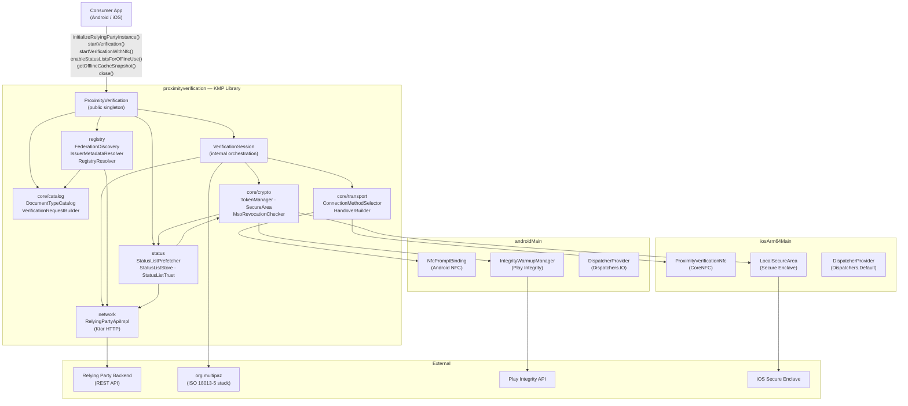
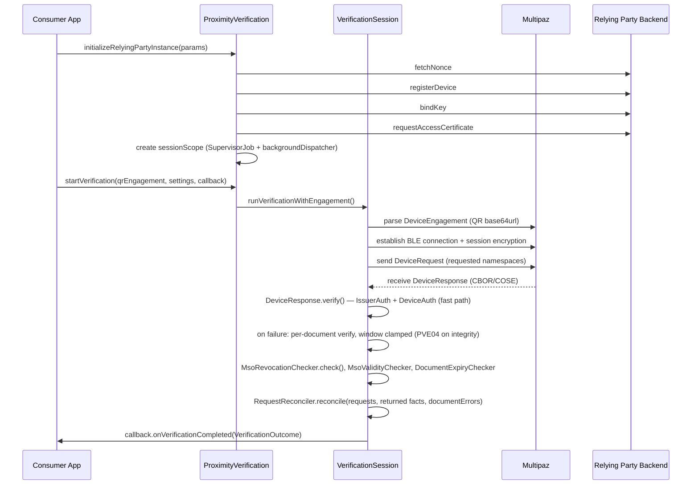
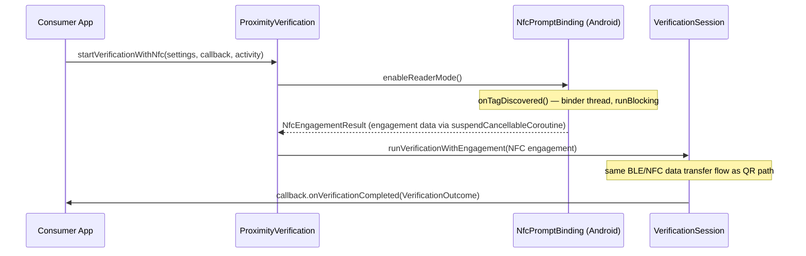
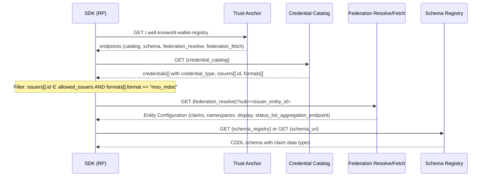

<!-- Last scan: 2026-05-08 -->
# High-Level Design

Kotlin Multiplatform library implementing the **ISO/IEC 18013-5** proximity document verification protocol (mDL reader role). Consumed by Android apps and iOS apps (iosArm64) to verify mobile documents via BLE or NFC.

## Architecture Overview

## Components

| Component | Description | Path |
|-----------|-------------|------|
| **ProximityVerification** | Public singleton: init, verify, lifecycle, dispatcher config | `commonMain/.../ProximityVerification.kt` |
| **VerificationSession** | Internal orchestration: engagement parsing, transport, DeviceResponse validation, callbacks. `verifyDeviceResponseDocuments()` returns `VerifiedDeviceResponse` (documents + typed `documentErrors`) | `commonMain/.../VerificationSession.kt` |
| **VerificationSessionLog** | Internal shape-of-session logging on `VerificationSession:REQ` / `:RESP`: requested docTypes and claim counts, returned data elements and **which are images by name**, denied docTypes, `RequestOutcome` summary, device-signed warning. Schema names and counts only — never data element values | `commonMain/.../VerificationSessionLog.kt` |
| **core/reconciliation** | `RequestReconciler` — pure, non-suspend reconciliation of requested claims against the issuer-signed elements actually returned; `ReturnedDocumentFacts` is the single contact point with multipaz's `MdocDocument` | `commonMain/.../core/reconciliation/` |
| **core/models/request** | Public `RequestOutcome` family: `DocumentRequestOutcome`, `DocumentRequestStatus`, `ClaimOutcome`, `ClaimStatus` | `commonMain/.../core/models/request/` |
| **core/catalog** | `DocumentTypeCatalog`, `VerificationRequestBuilder`, built-in credential configurations | `commonMain/.../core/catalog/` |
| **core/transport** | `ConnectionMethodSelector`, `HandoverBuilder` — BLE/NFC selection and handover | `commonMain/.../core/transport/` |
| **core/crypto** | `TokenManager`, `LocalSecureAreaFactory`, `MsoRevocationChecker`, `MsoValidityChecker`, `DocumentExpiryChecker`, device attestation, `CrlChecker` (cache-aware CRL revocation decision matrix); `crl/` subpackage owns `CrlStore`, `CrlPrefetcher`, `CrlHttpFetcher`, `IssuerCertChainExtractor`, `CrlMetaExtractor`. `offline/model/` owns the snapshot projection types `OfflineCacheSnapshot`, `CachedStatusListInfo`, `CachedCrlInfo` | `commonMain/.../core/crypto/`, `commonMain/.../crl/`, `commonMain/.../offline/` |
| **network** | `RelyingPartyApiImpl` (Ktor), API models, token refresh, nonce/register/bind/cert; shared `HttpClientProvider` | `commonMain/.../network/` |
| **registry** | OpenID Federation + IT-Wallet Registry resolution chain; populates `DocumentTypeCatalog` from federation metadata | `commonMain/.../registry/` |
| **status** | Token Status List (draft-13) prefetch, trust-anchored signing chain validation, persistent cache, offline-mode toggle (toggle key shared with CRL cache via `offline/OfflineModeFlag`); `CachedStatusList` extended with issuer-context fields (`issuerEntityId`, `credentialTypes`, `docTypes`); `StatusListPrefetchSummary` carries optional `crlSummary: CrlPrefetchSummary?` | `commonMain/.../status/` |
| **platform-android** | Android NFC (`NfcPromptBinding`), Bluetooth, Play Integrity, `Dispatchers.IO` | `androidMain/` |
| **platform-ios** | iOS NFC (CoreNFC), Secure Enclave (`LocalSecureArea`), `Dispatchers.Default` | `iosArm64Main/` |
| **samples** | Android sample app, iOS SwiftUI demo app | `samples/` |

## Key Design Decisions

- **KMP over separate codebases** — shared business logic in `commonMain` via `expect/actual`; platform specifics isolated in `androidMain`/`iosArm64Main`
- **DispatcherProvider injection** — no hardcoded `Dispatchers.*` in `commonMain`; consumers can override dispatchers; Android uses `Dispatchers.IO` for background, iOS uses `Dispatchers.Default`
- **Session-scoped coroutines** — `sessionScope` (SupervisorJob + backgroundDispatcher) created at `initialize()`, cancelled on `close()` or re-init; `activeVerificationJob` provides cancel-previous semantics for concurrent verification calls
- **Single `onVerificationCompleted` callback** — `VerificationOutcome` sealed class (`DocumentReceived` / `ProtocolFailed`) replaces dual success/failure callbacks; ISO check results (`PASSED/FAILED/NOT_DETERMINED`) are surfaced structurally, enriched by the optional `CheckMetadata` sealed hierarchy (`StatusListRevocation`, `CrlRevocation`, `MsoValidity`, `DocumentExpiry`)
- **Multipaz as protocol stack** — ISO 18013-5 device engagement, session encryption, CBOR/COSE serialization, and `DeviceResponse` parsing delegated to `org.multipaz:multipaz:0.99.0`. multipaz is read-only for this project: the only available lever is the consumed version
- **Per-document verification fallback** — multipaz's `DeviceResponse.verify()` is all-or-nothing and raises `IllegalStateException` both for integrity failures and for an out-of-window MSO. The aggregate call is kept as a fast path; on failure each document is re-verified in isolation on a rebuilt single-document response, with `atTime` clamped inside that document's MSO window so only the window check is neutralised (it is re-evaluated outcome-side by `MsoValidityChecker` against the real clock). **Fail-closed** on documents the per-document loop cannot isolate — `zkDocuments`, `encryptedDocuments`, `otherDocuments` keep `PVE04`
- **Claim mandatoriness is consumer policy, not SDK policy** — ISO/IEC 18013-5 cannot make a claim mandatory (an `ItemsRequest` is a wish-list; a response may legitimately be partial), so the SDK reconciles request against response and reports the inventory in `DocumentReceived.requestOutcome`, emitting no verdict and adding no `VerificationCheckType`. Enforcement must rest on `RETURNED` vs not-`RETURNED`: the wallet's `errors`/`documentErrors` maps carry no signature, so the `WITHHELD`/`ABSENT` distinction is diagnostic, never probative. See [2026-08-03 design](design/2026-08-03_request-outcome-reconciliation.md)
- **An empty response is still `DocumentReceived`** — a response with no documents, or one carrying only a non-`0` `status`, is not converted into a `ProtocolFailed`; the wallet's status reaches the consumer only through `SessionInfo.deviceResponseStatus`. Observed in the field: a wallet that does not trust the reader CA parses the request, shows the consent screen, then aborts with ISO status `10` (general error) and no documents — the reason appears only in the *wallet's* log (`CertPathValidatorException: Path does not chain with any of the trust anchors`), so no reader-side change can diagnose it. Reader-CA trust on the wallet is an integration prerequisite, not an error case
- **`runBlocking` in Android NFC callback** — required by Android NFC API (`onTagDiscovered()` on binder thread, tag handle expires at return); isolated from session scope; stale results discarded at `suspendCancellableCoroutine` boundary
- **MSO revocation returns `NOT_DETERMINED` offline** — `MsoRevocationChecker` never throws on network failure; returns `NOT_DETERMINED` when offline or format unknown; always re-throws `CancellationException`
- **Offline continuity policy** — if device is offline and stored security material exists, initialization and verification preserve existing token/cert material (explicit domain policy, not accidental behavior)
- **Federation registry resolves at init, with offline cache fallback** — `RegistryResolver` chains Federation Discovery → Trust Anchor registry discovery → Credential Catalog → per-issuer `federation_resolve` → optional Schema/Claims registries. Fail-fast 5 s per call; any failure degrades to the persisted `PROX_VER_REGISTRY_RESOLVED_DATA` blob. Single-tenant by design: switching `federationEntityUrl` or `allowedIssuerIds` overwrites the cache on next online resolve.
- **Status List prefetch is opt-in and toggle-gated** — `enableStatusListsForOfflineUse()` runs a sequential download/validate/persist loop (Token Status List draft-13 §9), anchors each signing chain via `TrustManagerInterface.verify`, and persists `PROX_VER_OFFLINE_ENABLED = "true"`. `MsoRevocationChecker` consults the cache only when the toggle is on (offline path) or as fallback when the live fetch fails (online path).
- **Status list parsing trust** — chain trust is enforced by `StatusListTrust` against `RelyingPartyProviderInfo.trustAnchors`; the actual JWS / COSE_Sign1 signature verification is delegated to multipaz `StatusList.fromJwt` / `fromCwt` with the resolved `EcPublicKey`.

See [rationale.md](rationale.md) for the full decision log.

## Main Verification Flows

### QR + BLE Engagement

### NFC Engagement (Android)

## Cross-Cutting Concerns

- **Error handling** — `VerificationException` codes `PVE00–PVE41` surfaced via `ProtocolFailed(reason)` in `VerificationOutcome`; `CancellationException` always re-thrown, never converted to domain errors; `close()` during active verification does not fire failure callbacks
- **Logging** — `LoggerConfig.delegateLogger` injectable; platform-specific: `android.util.Log` / `NSLog`; no external framework dependency. `MultipazLogBridge` routes multipaz's own logging through the same delegate. `VerificationSessionLog` adds shape-of-session diagnostics under `VerificationSession:REQ` / `:RESP`, deliberately factual: it recognises no request "shapes" and emits no product verdicts, because a reusable library that learned one consumer's rule would watch it change underneath and degrade silently
- **Secure storage** — Multipaz `LocalSecureArea`: Android Keystore (hardware-backed) on Android, Secure Enclave on iOS; factory via `LocalSecureAreaFactory` (expect/actual)
- **Network availability** — `NativeUtils.isNetworkAvailable()` is an SDK-level "usable internet" guard (not just network interface presence); used before backend-dependent operations

<!-- Ingested: 2026-05-09 -->
### Known external-dependency quirks

- **multipaz `extractCrlDistributionPoint` parser cast bug.** `TrustUtils.extractCrlDistributionPoint` casts the inner `DistributionPoint` element with `as? ASN1Sequence`. multipaz's `ASN1.decode` produces `ASN1TaggedObject` for context-specific `[0]` tags, so the cast yields `null` and the parser silently returns no URIs even on standards-compliant CRL DP extensions. Production wiring still uses the parser (most real certs match the unwrapped path); `CrlPrefetcher` exposes a `crlUriLookup: (X509Cert) -> List<String>` test-seam (default = the production parser) so test fixtures can synthesize CRL DPs without round-tripping through the buggy cast. Fix is out-of-scope follow-up — see rationale.md [2026-05-09].
- **multipaz `X509Crl` lazy ASN.1 decode.** `X509Crl(ByteString(bytes))` stores bytes lazily and only validates on first property access. Both `CrlPrefetcher` and `CrlChecker` defensively read `crl.version` immediately after construction to force the ASN.1 decode and detect malformed payloads before persistence/use.
- **Kotlin Multiplatform `:allTests` task availability.** The KMP plugin synthesizes `:allTests` only when the module declares at least one host-runnable target. This module declares `androidTarget()` + `iosArm64()` (real-device-only) — no `iosSimulatorArm64()` — so `:allTests` is not generated. Use `:proximityverification:test` (Android JVM unit-test variants) instead; it executes the entire `commonTest` source set. Quality gates and CI scripts MUST reference `:test`. Adding `iosSimulatorArm64()` would also enable `:allTests` and is a candidate follow-up. Caveat when running a single test: `:proximityverification:test` is an aggregate lifecycle task and **rejects** `--tests` ("Unknown command-line option"); use `:proximityverification:testDebugUnitTest --tests "*X*"`.
- **Kotlin/Native mangles Objective-C keywords in exported names.** A property named `namespace` is exported to Swift as `namespace_` — the generated header may be included from Objective-C++, where it is a keyword — and `@ObjCName(exact = true)` is not applicable to properties. Every public field on a KMP type must therefore be checked against the `swift_name` in the generated header before release: run `./gradlew :proximityverification:linkPodReleaseFrameworkIosArm64` and read `proximityverification/build/bin/iosArm64/podReleaseFramework/proximityverification.framework/Headers/proximityverification.h`. Hit twice so far and resolved by renaming the field: `ClaimDescriptor.ns` (see rationale.md [2026-03-12]) and `ClaimOutcome.nameSpace`.

## IT-Wallet Federation Registry Integration

<!-- Ingested: 2026-04-24 — Phase 1 implemented in commits a0e4c98..6574421 (May 2026) -->

The SDK includes a `registry/` module (Phase 1) that resolves **IT-Wallet Federation Registry** metadata at `initializeRelyingPartyInstance()` time, dynamically discovering credential types, issuer metadata, and claim schemas from the OpenID Federation trust infrastructure. The chain orchestrator is `registry/RegistryResolver` — see the [registry component doc](registry/README.md) for the full implementation contract. Phase 1 does **not** validate JWS / Entity Statement signatures; that is deferred to a later phase.

### Registry Architecture (IT-Wallet)

The IT-Wallet ecosystem exposes a registry infrastructure through the Trust Anchor with 6 components discoverable at `GET /.well-known/it-wallet-registry`:

| Component | Endpoint key | Purpose |
|-----------|-------------|---------|
| Claims Registry | `claims_registry` | Standardized semantic definitions for credential attributes (type, validation) |
| AS Registry | `authentic_sources` | Authentic Source capabilities (non-public, CI-facing) |
| Federation Registry | `federation_list/fetch/resolve` | Cryptographic trust chain and entity validation |
| **Digital Credentials Catalog** | `credential_catalog` | Credential types, authorized issuers, formats, schema_uri |
| **Schema Registry** | `schema_registry` | CBOR/CDDL schemas (mso_mdoc) and JSON schemas (dc+sd-jwt) |
| Taxonomy | `taxonomy` | Domain/purpose classification |

### Metadata Resolution Chain (RP perspective)

The SDK, acting as a Relying Party component, needs to resolve credential metadata through this chain:

### Key Design Constraint: Decentralized Metadata (§7.6.3)

Per the IT-Wallet specification, the **canonical source** for display characteristics and claim structure is the **Credential Issuer's Entity Configuration** (resolved via federation), not the catalog. The catalog is lightweight — it provides `credential_type`, `issuers[].id`, `formats[].format`, `formats[].docType`, and `formats[].schema_uri`, but delegates claims, namespaces, and display to the issuer metadata.

The `status_list_aggregation_endpoint` is also only available from the issuer Entity Configuration, not from the catalog.

### OpenID Federation Trust Model

The trust infrastructure follows [OpenID Federation 1.0 (draft 42)](https://openid.net/specs/openid-federation-1_0.html):
- **Trust Anchor** publishes Entity Configuration at `.well-known/openid-federation` and federation endpoints (list, fetch, resolve, trust_mark_status)
- **federation_resolve** resolves an entity's metadata with Trust Chain verification
- **federation_fetch** fetches a Subordinate Statement from a Superior
- The SDK receives the Trust Anchor reference from its RP backend at initialization time

## Related Documents

- [AGENTS.md](../AGENTS.md) — Operational contract for AI agents
- [INTEGRATION_GUIDE.md](INTEGRATION_GUIDE.md) — Consumer integration guide
- [rationale.md](rationale.md) — Non-obvious decisions with reasoning
- [core-api](core-api/) — ProximityVerification + VerificationSession
- [network](network/) — Ktor HTTP client and Relying Party API
- [crypto](crypto/) — Token management, secure areas, revocation
- [transport](transport/) — BLE/NFC transport selection
- [catalog](catalog/) — Document type catalog and request builder
- [registry](registry/) — Federation + IT-Wallet registry resolution chain
- [status](status/) — Token Status List prefetch and offline-mode toggle
- [platform-android](platform-android/) — Android platform specifics
- [platform-ios](platform-ios/) — iOS platform specifics
- [Deployment](deployment.md) — Build scripts and distribution
