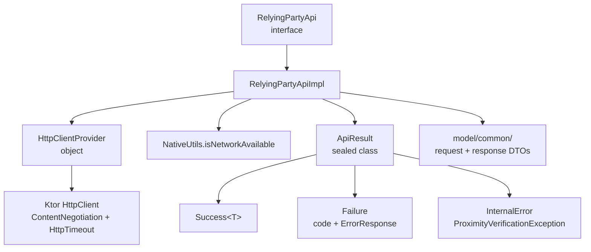
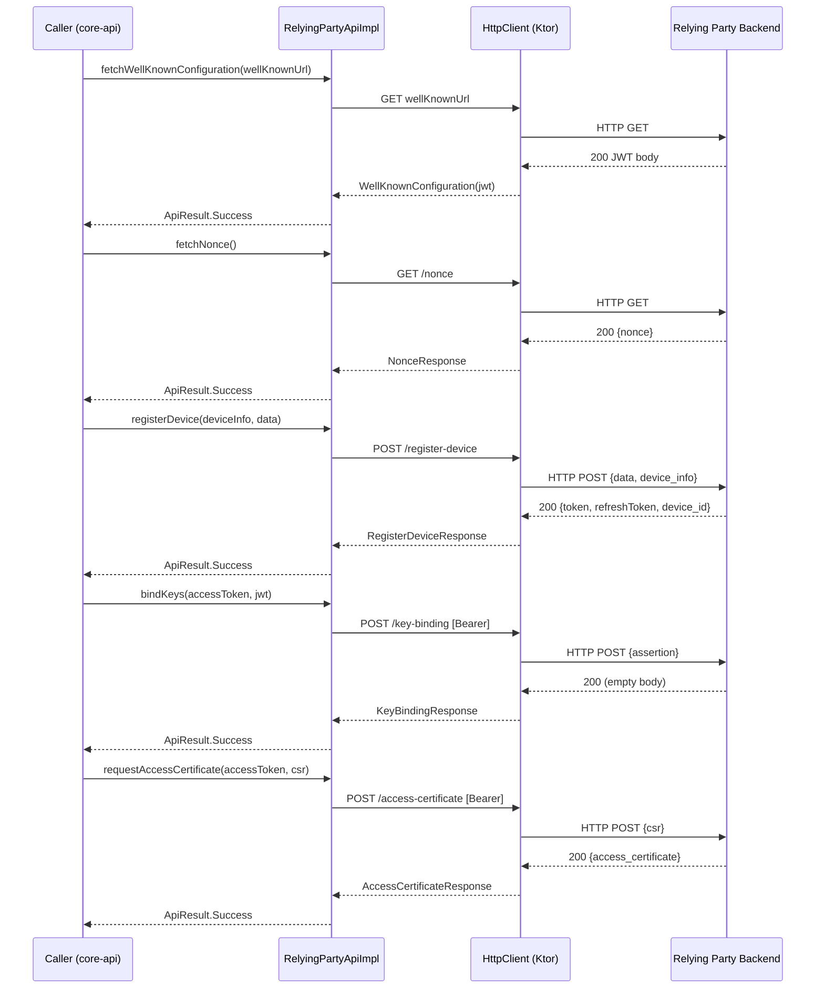

# network

Ktor-based HTTP client layer that handles all communication between the KMP library and the Relying Party backend. Exposes a single `RelyingPartyApi` interface covering the full device lifecycle: well-known discovery, nonce fetch, device registration, token refresh, key binding, and access-certificate issuance.

## Responsibility

**Owns:**
- The `RelyingPartyApi` contract and its `RelyingPartyApiImpl` implementation
- Serialization/deserialization of all request and response models (`model/common/`)
- Uniform error mapping: HTTP status codes → typed `ApiResult` variants, with per-call timeout enforcement
- Network-availability pre-check via `NativeUtils.isNetworkAvailable()` before every call

**Does NOT own:**
- Token storage or refresh orchestration (that lives in `core/crypto` / `TokenManager`)
- Transport-layer concerns (BLE/NFC — see `transport/`)
- Business logic that acts on the returned data (callers in `core-api/` drive sequencing)

## Architecture

## Key Files

| File | Notable symbols |
|------|-----------------|
| `RelyingPartyApi.kt` | `RelyingPartyApi` — interface declaring all 6 suspend methods |
| `RelyingPartyApiImpl.kt` | `RelyingPartyApiImpl` — concrete Ktor implementation; `restError()` for status → exception mapping |
| `HttpClientProvider.kt` | `HttpClientProvider.client` — singleton `HttpClient` with `ContentNegotiation` (lenient JSON) and global timeouts |
| `model/ApiResult.kt` | `ApiResult<T>` — sealed class: `Success`, `Failure`, `InternalError` |
| `model/common/RegisterDeviceResponse.kt` | `RegisterDeviceResponse` / `RegisterDeviceResponseData` — carries `token`, `refreshToken`, `device_id` returned at registration |

## Primary Flow

`refreshToken(refreshToken)` follows the same pattern as the steps above (POST `/refresh-token`) and may be called out-of-band by the caller whenever the access token expires.

## Dependencies

**Internal**
- `core/handlers` — `NativeUtils.isNetworkAvailable()`: platform-specific reachability check injected into `RelyingPartyApiImpl` as a lambda, allowing test overrides
- `exceptions/` — `ProximityVerificationException` / `ProximityVerificationExceptionCode` (PVE08, PVE15–PVE23): all error paths wrap exceptions with these typed codes

**External**
- `io.ktor:ktor-client-core:2.3.13`
- `io.ktor:ktor-client-content-negotiation:2.3.13`
- `io.ktor:ktor-serialization-kotlinx-json:2.3.13`
- `io.matthewnelson.encoding:base64` (imported in impl, used for potential future encoding needs)
- Relying Party backend REST API (base URL provided at construction time)

## Configuration

`RelyingPartyApiImpl` receives its `baseUrl` at construction; callers obtain this from `RelyingPartyInstanceParams` or by parsing the JWT inside `WellKnownConfiguration` (fetched via `fetchWellKnownConfiguration`).

Per-call timeouts are applied uniformly via both the `HttpClientProvider` global defaults and explicit per-request overrides in each method:

| Timeout | Value |
|---------|-------|
| Connect | 15 000 ms |
| Socket  | 25 000 ms |
| Request | 45 000 ms |

The `HttpClient` instance can be replaced at runtime with `RelyingPartyApiImpl.overrideClient()` — used in tests to inject a mock engine.

## Related Documents

- [High-Level Design](../high-level-design.md)
- [core-api](../core-api/)
- [crypto](../crypto/)
