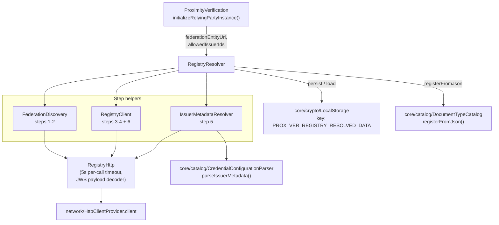
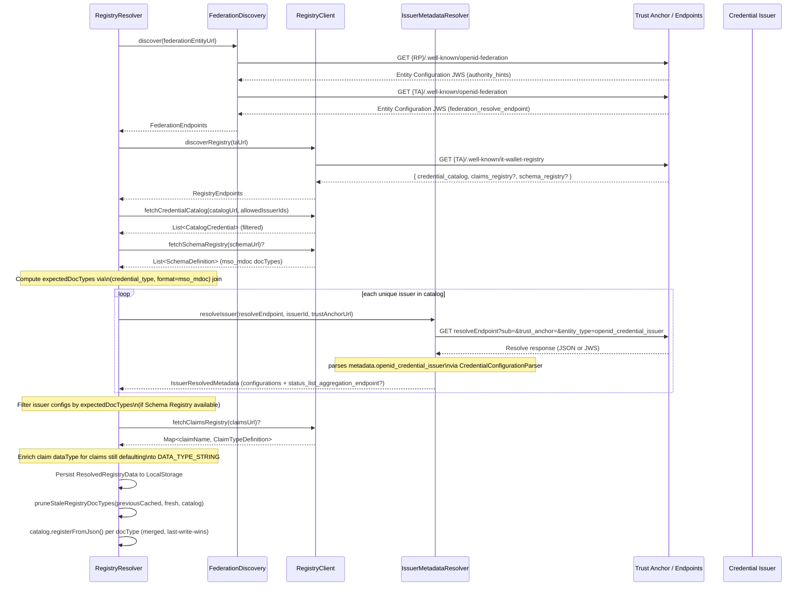

# registry

Resolves IT-Wallet **Federation Registry** metadata at SDK initialization: discovers federation endpoints from the RP Entity Configuration, fetches the Digital Credentials Catalog, resolves each authorized issuer's metadata via OpenID Federation `federation_resolve`, optionally enriches claim data types from the Claims Registry, and registers the produced `CredentialConfiguration`s into the SDK's `DocumentTypeCatalog`.

## Responsibility

**Owns:**
- Federation discovery: RP entity configuration → Trust Anchor → `federation_resolve` / `federation_fetch` endpoints (`FederationDiscovery`)
- IT-Wallet registry endpoint discovery at `{TA}/.well-known/it-wallet-registry` (`RegistryClient.discoverRegistry`)
- Digital Credentials Catalog parsing — `credential_type` + `issuers[].id` + `restriction_policy.presentation_flows.proximity` filter (`RegistryClient.fetchCredentialCatalog`)
- Schema Registry parsing — `(credential_type, format, docType)` correlator for `mso_mdoc` filtering (`RegistryClient.fetchSchemaRegistry`)
- Per-issuer metadata resolution — `federation_resolve?sub=<issuer>&trust_anchor=<TA>` → `metadata.openid_credential_issuer` parsed via `CredentialConfigurationParser` (`IssuerMetadataResolver`)
- Claims Registry fetch and `claimName → ClaimTypeDefinition` lookup, including alias resolution (`RegistryClient.fetchClaimsRegistry`)
- End-to-end orchestration with offline fallback to cache and pruning of stale registry-registered docTypes (`RegistryResolver`)
- Single-tenant persistence of the resolved blob under `LocalStorage` key `PROX_VER_REGISTRY_RESOLVED_DATA`

**Does NOT own:**
- JWS / Entity Statement signature verification — Phase 1 decodes JWS payloads without cryptographic validation (federation trust chain not yet in scope)
- Token Status List download or validation — handled by `status/` (status_list_aggregation_endpoint is extracted here, consumed there)
- Ktor `HttpClient` configuration — uses the shared `network/HttpClientProvider.client`
- Document type catalog data structure itself — owned by `core/catalog`

## Architecture

## Key Files

| File | Key entry points |
|------|-----------------|
| `registry/RegistryResolver.kt` | `RegistryResolver.resolve(federationEntityUrl, allowedIssuerIds, catalog, storage)` — full chain with offline fallback; `STORAGE_KEY = "PROX_VER_REGISTRY_RESOLVED_DATA"` |
| `registry/FederationDiscovery.kt` | `FederationDiscovery.discover(federationEntityUrl)` — steps 1-2: RP config → `authority_hints` → TA config → `federation_resolve_endpoint` |
| `registry/RegistryClient.kt` | `discoverRegistry(taUrl)`, `fetchCredentialCatalog(catalogUrl, allowedIssuerIds)`, `fetchSchemaRegistry(url)`, `fetchClaimsRegistry(url)` |
| `registry/IssuerMetadataResolver.kt` | `resolveIssuer(resolveEndpoint, issuerEntityId, trustAnchorUrl)` — retries without `entity_type` parameter when first attempt fails |
| `registry/RegistryHttp.kt` | `RegistryHttp.getOrNull()`, `getJsonOrJwsPayload()`, `decodeJwsPayload()`, `federationEntityConfigUrl()`, `walletRegistryDiscoveryUrl()`; `CALL_TIMEOUT_MILLIS = 5_000L` |
| `registry/model/*.kt` | `FederationEndpoints`, `RegistryEndpoints`, `CatalogCredential`, `SchemaDefinition`, `IssuerResolvedMetadata`, `ClaimTypeDefinition`, `ResolvedRegistryData` |

## Resolution Chain

## Behavioural Contract

- **Never throws on registry failures.** Online failure in steps 1-4 collapses to `null` and the resolver falls back to the cached `ResolvedRegistryData` (`PROX_VER_REGISTRY_RESOLVED_DATA`). Step 5 failures are per-issuer — partial success is allowed. Step 6 (Claims Registry) is fully non-blocking — `KNOWN_ELEMENT_TYPES` in `CatalogBridge` covers ISO 18013-5 claims.
- **`CancellationException` always re-thrown** — every `try { ... } catch (e: Throwable)` branch re-throws cancellation first.
- **Single-tenant cache.** The persisted blob is keyed globally — switching `federationEntityUrl` or `allowedIssuerIds` is a re-init event, the next online resolution overwrites. Consumers that need to invalidate explicitly call `ProximityVerification.clearLibraryLocalStorage()`.
- **Offline path.** When `NativeUtils.isNetworkAvailable() == false`, the resolver loads the cached blob (if any) and applies it to the catalog without touching the network.
- **Stale-pruning.** docTypes registered by a previous resolution but absent from the fresh one are unregistered from the catalog *only if* the current entry equals what the previous resolution registered (data-class equality) — manual `registerFromJson()` overrides are preserved.
- **Phase 1 does not validate JWS signatures.** `RegistryHttp.decodeJwsPayload()` Base64URL-decodes the middle segment; the federation trust chain is out of scope until a later phase.
- **Per-call timeout = 5 s** (`RegistryHttp.CALL_TIMEOUT_MILLIS`) — fail-fast and offline-friendly so a long DNS/socket stall cannot block initialization.
- **Direct-federation fallback (v0.6.5).** When the full registry chain (steps 1–4) fails *and* the local cache is empty *and* `allowedIssuerIds` is non-empty, the resolver bypasses steps 2–4 and resolves each known issuer directly via federation Step 1+5 (`RegistryResolver.resolveFromAllowedIssuers`). This path skips Claims Registry enrichment. The resulting `ResolvedRegistryData` is persisted and applied to the catalog. Also exposed as `RegistryResolver.resolveDirectFederationFallback()` (internal) for the lazy re-resolve triggered by `enableStatusListsForOfflineUse()` when `resolvedRegistryData` is null.

## Catalog Filtering Rules

1. **Issuer filter** (step 4) — when `allowedIssuerIds` is non-empty, only catalog entries whose `issuers[].id` intersects the set are kept. Empty list disables the filter.
2. **Proximity policy** (step 4 / `RegistryResolver.filterProximityCredentials`) — entries whose Trust Anchor extension `restriction_policy.presentation_flows.proximity == false` are dropped. Missing or `true` ⇒ eligible.
3. **Format/docType filter** (step 5 post-processing / `filterIssuerMetadataByExpectedDocTypes`) — when the Schema Registry is available, an issuer's `mso_mdoc` configurations are restricted to docTypes computed from `(credentialType, format=mso_mdoc)` rows of the schema list. Issuers left with zero configurations are dropped. Without Schema Registry, the original configurations are kept (degraded mode).

## Claim Type Enrichment (step 6)

`enrichWithClaimTypes` overrides `ClaimDescriptor.dataType` only for claims whose current value equals `DATA_TYPE_STRING`. Lookup is by canonical `identifier` first, then by aliases (canonical wins on collision). Mapping table (`RegistryResolver.mapRegistryType`):

| Registry `type` (+ `format`) | SDK `DATA_TYPE_*` |
|------------------------------|-------------------|
| `string` + `date` | `DATE` |
| `string` + `data` / `binary` | `STRING` (deferred) |
| `string` + `uri` | `STRING` |
| `string`, `email`, `url` | `STRING` |
| `date` | `DATE` |
| `boolean` | `BOOLEAN` |
| `numeric`, `number`, `integer` | `NUMBER` |
| `image` | `PICTURE` |
| `array`, `object` | `COMPLEX` |
| anything else | `STRING` |

**Binary disambiguation deferred to catalog (`string + data|binary`):** these shapes intentionally return `DATA_TYPE_STRING` rather than `DATA_TYPE_BLOB`, so `enrichWithClaimTypes` does not override the claim's default `STRING` dataType. The picture-vs-blob decision is then taken by `CatalogBridge.KNOWN_ELEMENT_TYPES` via the claim's identifier (`portrait` → `Picture`, `signature_usual_mark` → `Picture`, `biometric_template_face` → `Picture`, `biometric_template_finger` → `Blob`). Returning `BLOB` here would short-circuit that fallback because `CatalogBridge.resolveAttributeType` only consults `KNOWN_ELEMENT_TYPES` when `dataType == STRING`. **Trade-off:** a registry-published identifier not listed in `KNOWN_ELEMENT_TYPES` and shaped as `string + data|binary` resolves to `String` rather than `Blob`; new biometric/image identifiers must be added to that table when the registry introduces them.

**Known limitation:** `CredentialConfigurationParser` defaults missing `value_type` to `DATA_TYPE_STRING`, so the resolver cannot distinguish "issuer omitted `value_type`" from "issuer explicitly published `value_type: \"string\"`" — both are eligible for override. Benign today; revisit if production issuers start publishing `value_type` explicitly.

## Configuration

| Field | Source | Purpose |
|-------|--------|---------|
| `federationEntityUrl` | `RelyingPartyProviderInfo.federationEntityUrl` | Base entity URL of the RP in the federation; SDK appends `.well-known/openid-federation` |
| `allowedIssuerIds` | `RelyingPartyInstanceParams.allowedIssuerIds` | Issuer entity IDs whitelist applied at step 4; empty list = no filter |
| `trustAnchors` | `RelyingPartyProviderInfo.trustAnchors` | Used by `status/StatusListTrust` to anchor signing chains; not used by the registry chain (Phase 1) |

## Dependencies

**Internal:**
- `core/catalog.DocumentTypeCatalog` — receives `registerFromJson(...)` calls
- `core/catalog.CredentialConfigurationParser.parseIssuerMetadata()` — used by `IssuerMetadataResolver` to parse `metadata.openid_credential_issuer`
- `core/crypto.LocalStorage` — persists the resolved blob
- `core/handlers.NativeUtils.isNetworkAvailable()` — offline gate
- `network/HttpClientProvider.client` — shared Ktor client
- `network/HttpErrorLogger.logHttpErrorResponse` — OpenID Federation §8.9 error format diagnostics

**External:**
- `io.ktor:ktor-client-core` — HTTP transport, `accept`, timeouts
- `org.jetbrains.kotlinx:kotlinx-serialization-json` — JSON parsing
- `org.multipaz:multipaz` — `fromBase64Url` for JWS payload decoding

## Storage

| Key | Value |
|-----|-------|
| `PROX_VER_REGISTRY_RESOLVED_DATA` | JSON-encoded `ResolvedRegistryData` (credentials, issuerMetadata, claimTypes, schemas, resolvedAtEpochMillis) |

Cleared together with the rest of the SDK state by `ProximityVerification.clearLibraryLocalStorage()`.

## Related Documents

- [High-Level Design](../high-level-design.md) — § *Planned: IT-Wallet Federation Registry Integration*
- [IT-Wallet Registry Discovery](../IT-WALLET-REGISTRY_DISCOVERY.md) — Trust Anchor `it-wallet-registry` shape
- [status component](../status/README.md) — consumes `status_list_aggregation_endpoint` extracted here
- [catalog component](../catalog/README.md) — destination of `registerFromJson()` calls
- [rationale.md](../rationale.md) — Federation discovery, JWS payload decode without signature validation, single-tenant cache decisions
