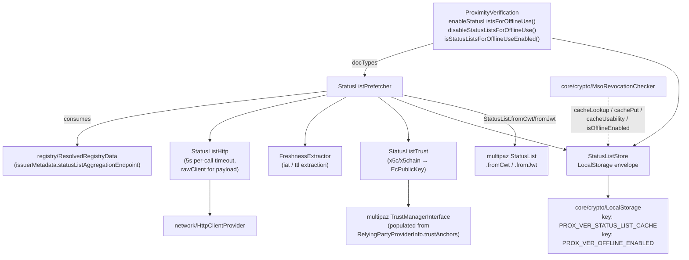
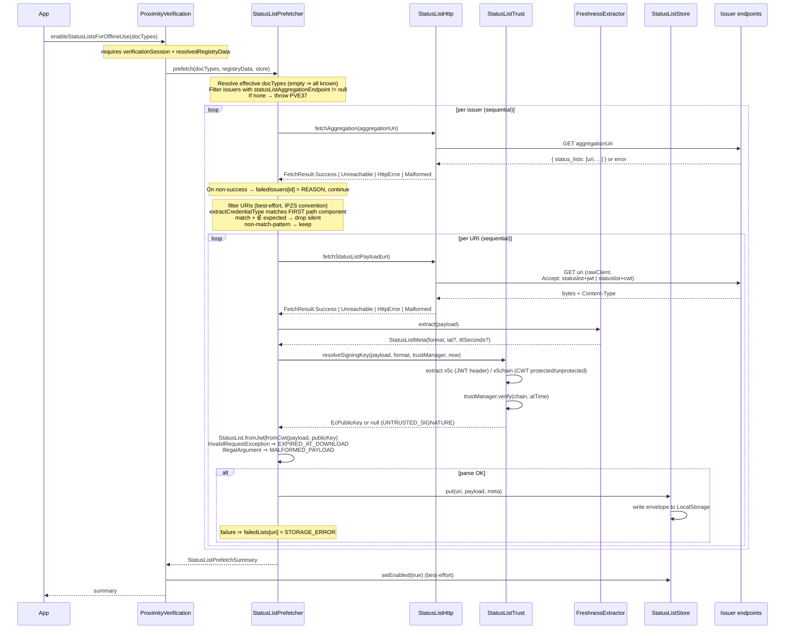

# status

Implements the **Token Status List** (draft-13) prefetch and offline-verification toggle. Downloads each authorized issuer's status lists at the consumer's request, validates their signing chains against the SDK's trust anchors, and persists them so MSO revocation checks can fall back to (or stay on) the cache when the device is offline.

## Responsibility

**Owns:**
- Token Status List aggregation endpoint and payload fetch (`StatusListHttp`, JWT/CWT bytes)
- Freshness extraction (`iat`, `ttl`) from JWT or CWT envelopes without signature verification (`FreshnessExtractor`)
- Trust resolution: extracts the `x5c` / `x5chain` from the token header and verifies the chain against `TrustManagerInterface` (`StatusListTrust`)
- Persistent envelope cache `{ uri → CachedStatusList }` under `LocalStorage` key `PROX_VER_STATUS_LIST_CACHE` (`StatusListStore`)
- The `PROX_VER_OFFLINE_ENABLED` toggle and freshness classification (`Fresh` vs `StaleByTtl`) for use-time fallback logic
- Per-issuer / per-list orchestration, error categorization, and prefetch summary (`StatusListPrefetcher`)

**Does NOT own:**
- `RevocationStatus.StatusList` payload parsing — delegated to multipaz `StatusList.fromCwt` / `StatusList.fromJwt`
- The MSO revocation decision itself — wired into `core/crypto/MsoRevocationChecker.checkStatusList` (lookup / write-through / fallback)
- Trust anchor configuration — sourced from `RelyingPartyProviderInfo.trustAnchors` populated into the `TrustManagerInterface` by `Utils.populateTrustManager()`
- Aggregation endpoint discovery — extracted by `registry/IssuerMetadataResolver` and surfaced via `IssuerResolvedMetadata.statusListAggregationEndpoint`

## Architecture

## Key Files

| File | Key entry points |
|------|-----------------|
| `status/StatusListPrefetcher.kt` | `StatusListPrefetcher.prefetch(docTypes, registryData, store)` — sequential per-issuer / per-URI fetch, returns `StatusListPrefetchSummary` |
| `status/StatusListHttp.kt` | `fetchAggregation(uri)` (JSON, draft-13 §9), `fetchStatusListPayload(uri)` (raw bytes via `HttpClientProvider.rawClient`); `FetchResult` sealed class (`Success`, `Unreachable`, `HttpError`, `Malformed`); `CALL_TIMEOUT_MILLIS = 5_000L` |
| `status/StatusListStore.kt` | `put` (now accepts optional context: `issuerEntityId`, `credentialTypes`, `docTypes` — defaulted, back-compat preserved), `get`, `listAll()` (mirrors `CrlStore.listAll`; powers `getOfflineCacheSnapshot`), `decodePayload`, `usability`, `isEnabled`, `setEnabled`, `clearEntries`; `STORAGE_KEY = "PROX_VER_STATUS_LIST_CACHE"`, `STORAGE_KEY_ENABLED = OfflineModeFlag.STORAGE_KEY` (`"PROX_VER_OFFLINE_ENABLED"`, shared with `CrlStore`) |
| `status/FreshnessExtractor.kt` | `FreshnessExtractor.extract(payload)` — extracts `iat` / `ttl` from JWT (claims `iat`, `ttl`) or CWT (CBOR labels `6`, `65534`); never throws on malformed input |
| `status/StatusListUriFilter.kt` | `StatusListUriFilter.extractCredentialType(uri): String?` (returns the URL-decoded credential_type when `statuslists` is the first path component, `null` otherwise); `StatusListUriFilter.retain(uris, expected): FilterOutcome` (best-effort partition with lenient pass-through for non-pattern URIs) |
| `status/StatusListTrust.kt` | `StatusListTrust.resolveSigningKey(payload, format, trustManager, atTime)` — chain-anchored `EcPublicKey` (or `null` if untrusted / no chain) |
| `status/model/CachedStatusList.kt` | Persisted envelope row: `uri, format, payloadBase64, iat?, ttlSeconds?, fetchedAtEpochMillis` plus optional context appended in 2026-05-09 — `issuerEntityId: String? = null, credentialTypes: List<String> = emptyList(), docTypes: List<String> = emptyList()`. New fields default-safe; legacy envelopes deserialize unchanged via `Json { ignoreUnknownKeys = true; encodeDefaults = true }` |
| `status/model/Usability.kt` | `Fresh`, `StaleByTtl` (Expired is decided at use time by multipaz `validateXxx`) |
| `status/model/FailureReason.kt` | `AGGREGATION_UNREACHABLE`, `AGGREGATION_HTTP_ERROR`, `AGGREGATION_MALFORMED`, `FETCH_UNREACHABLE`, `FETCH_HTTP_ERROR`, `MALFORMED_PAYLOAD`, `EXPIRED_AT_DOWNLOAD`, `UNSUPPORTED_FORMAT`, `UNTRUSTED_SIGNATURE`, `STORAGE_ERROR` |
| `status/model/StatusListPrefetchSummary.kt` | Public result: `requestedDocTypes`, `resolvedIssuers`, `fetchedLists`, `failedLists`, `failedIssuers`, `persistedAtEpochMillis`, plus `crlSummary: CrlPrefetchSummary? = null` (appended 2026-05-09; `null` when `enableStatusListsForOfflineUse` runs status-list-only or the CRL prefetch threw — never absent in successful CRL paths) |

## Prefetch Flow

## Behavioural Contract

- **Sequential by design** — `StatusListPrefetcher` iterates issuers and URIs sequentially (not concurrent). Captured in design `2026-05-04_offline-status-list-concurrency-fixes.md` to keep storage writes serialized and avoid envelope-level interleaving on `LocalStorage`.
- **Per-URI credential_type filter (best-effort, IPZS convention).** When an issuer's aggregation response contains URIs of the form `{scheme}://{host}[:port]/statuslists/{credential_type}/{*}` (with `statuslists` as the FIRST path component), the prefetcher filters them by correlating `credential_type` against the set derived from `registryData.schemas` for the requested `docTypes`. URIs not matching the pattern are kept (lenient). URIs matching the pattern with `credential_type ∉ expected` are dropped silently — they do NOT appear in `fetchedLists` nor in `failedLists`. The filter auto-disables when `registryData.schemas` is empty or no correlation exists. See [`StatusListUriFilter.kt`](../../proximityverification/src/commonMain/kotlin/it/infocert/proximityverification/status/StatusListUriFilter.kt) and rationale.md [2026-05-08] *URI-Based credential_type Filter Best-Effort (IPZS Convention)*.
- **Never aborts.** All transport / parse / storage errors land in `failedLists` or `failedIssuers` — the prefetch always returns a structured summary. The only throws are upstream guards: `PVE37` (no eligible issuer) and `PVE38` (unknown docType requested).
- **`CancellationException` always re-thrown** at every catch site (`prefetch`, `parseAndValidate`, `store.put`, etc.).
- **`store.put` failures don't add to `fetched`.** A successful parse followed by a failed `put` produces `failedLists[uri] = STORAGE_ERROR`; the URI is **not** in `fetchedLists`.
- **Use-time fallback (`MsoRevocationChecker.checkStatusList`):**
  - Online + live fetch OK → `cachePut` is best-effort (logged on failure, never affects outcome) and `mode = ONLINE_LIVE`.
  - Online + live fetch failed → cache lookup; `Fresh` ⇒ `ONLINE_FALLBACK_CACHE_FRESH`, `StaleByTtl` ⇒ `ONLINE_FALLBACK_CACHE_STALE`. Payload `exp` is decided by multipaz at parse time.
  - Offline + `isOfflineEnabled() == true` → cache-only path (`OFFLINE_CACHE_FRESH` / `OFFLINE_CACHE_STALE`).
  - Offline + `isOfflineEnabled() == false` → `OFFLINE_DISABLED_NOT_DETERMINED` ⇒ `CheckStatus.NOT_DETERMINED`.
- **Trust resolution uses `TrustManagerInterface.verify(chain, atTime)`.** No JWS / COSE_Sign1 signature verification is done in this module — that step is delegated to multipaz `StatusList.fromJwt` / `StatusList.fromCwt`, which receive the resolved `EcPublicKey`.
- **Phase 1 logging-only `ValidationMode`.** `core/crypto/ValidationMode` is `internal`: it labels how the decision was reached for diagnostics, with future Phase 2 hook for `VerificationOutcome` enrichment.

## Public API (on `ProximityVerification`)

| Method | Behaviour |
|--------|-----------|
| `enableStatusListsForOfflineUse(docTypes: List<String> = emptyList())` | Requires init + resolved registry; runs prefetch and persists `PROX_VER_OFFLINE_ENABLED = "true"` even if the summary contains partial failures. Returns `StatusListPrefetchSummary`. |
| `disableStatusListsForOfflineUse()` | Persists `PROX_VER_OFFLINE_ENABLED = "false"` and clears `PROX_VER_STATUS_LIST_CACHE`. Idempotent, callable any time, never throws on storage I/O failures. |
| `isStatusListsForOfflineUseEnabled()` | Returns the persisted flag (default `false`). Callable any time. |

## Exception Codes

| Code | Trigger |
|------|---------|
| `PVE01` | `enableStatusListsForOfflineUse` called before init, or no `TrustManager` available |
| `PVE40` | Device offline at the time of `enableStatusListsForOfflineUse()`. Connectivity pre-check (`NativeUtils.isNetworkAvailable()`) runs immediately after `PVE01` and before any federation pre-check, prefetch, or store write — persisted state left untouched |
| `PVE37` | `enable…` called when no issuer in the resolved registry exposes a `status_list_aggregation_endpoint` for the requested docTypes |
| `PVE38` | `enable…` requested an unknown docType (not in the resolved registry) |
| `PVE39` | Reserved: status list cache I/O error class (used as a labelled umbrella; today individual storage failures land in `failedLists` as `STORAGE_ERROR`) |

## Storage

| Key | Value |
|-----|-------|
| `PROX_VER_STATUS_LIST_CACHE` | JSON envelope `{ entries: { <uri>: CachedStatusList } }` (single-tenant, mirrors registry pattern) |
| `PROX_VER_OFFLINE_ENABLED` | `"true"` / `"false"` flag for the offline-verification toggle |

Both keys are cleared by `ProximityVerification.clearLibraryLocalStorage()`.

## Dependencies

**Internal:**
- `registry/ResolvedRegistryData` — source of `(issuerEntityId, statusListAggregationEndpoint, credentialConfigurations[].docType)` triples
- `core/crypto/LocalStorage` — envelope persistence
- `core/crypto/MsoRevocationChecker` — consumes `cacheLookup`, `cachePut`, `cacheUsability`, `isOfflineEnabled` lambdas
- `network/HttpClientProvider.client` and `HttpClientProvider.rawClient` — payload fetch uses `rawClient` to avoid `Accept: application/json` injection (see code comment in `StatusListHttp`)
- `network/HttpErrorLogger.logHttpErrorResponse` — non-2xx diagnostics

**External:**
- `org.multipaz:multipaz` — `StatusList.fromCwt`, `StatusList.fromJwt`, `TrustManagerInterface.verify`, `X509CertChain.fromX5c` / `fromDataItem`, `CoseSign1`, `Cbor`
- `io.ktor:ktor-client-core` — HTTP transport, `accept`, `bodyAsBytes`, timeouts
- `org.jetbrains.kotlinx:kotlinx-serialization-json` — envelope JSON, JWT claims

## Format Detection (`FreshnessExtractor`)

1. `Content-Type` of the response: `application/statuslist+jwt` ⇒ JWT, `application/statuslist+cwt` ⇒ CWT (also matches `application/jwt` and `application/cwt`).
2. Heuristic when the header is missing: payload is three Base64URL segments separated by `.` ⇒ JWT; otherwise CWT.

CWT freshness reads CBOR map keys `6` (`iat`) and `65534` (`ttl`); JWT reads JSON claims `iat` and `ttl`.

## Related Documents

- [High-Level Design](../high-level-design.md)
- [registry component](../registry/README.md) — source of `statusListAggregationEndpoint` extracted at step 5
- [crypto component](../crypto/README.md) — `MsoRevocationChecker` integrates the cache lambdas
- [rationale.md](../rationale.md) — Offline verification toggle, single-tenant cache, sequential prefetch decisions
The design documents this component was built from (`2026-04-28` prefetch, `2026-05-04` concurrency fixes, `2026-05-08` verification toggle) were deliberately removed from the repo — see commit `0106ba7`. Their decisions survive as rationale.md entries dated the same days.
