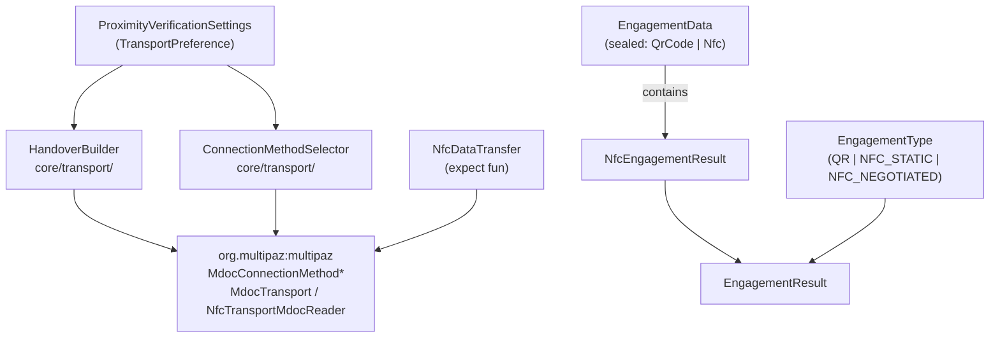
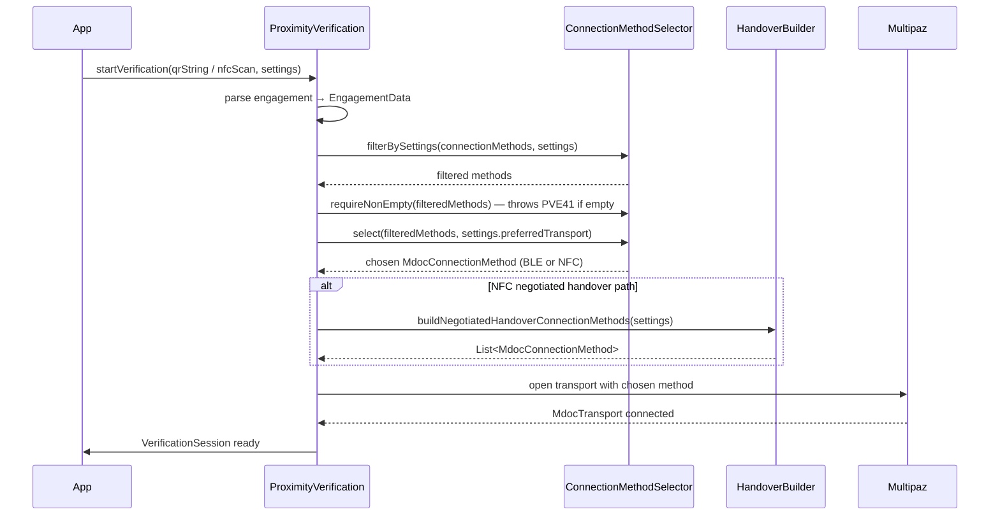

# transport

Provides policy-driven transport selection and handover message building for ISO/IEC 18013-5 proximity verification, bridging parsed engagement data to a concrete BLE or NFC connection method before the verification session begins.

## Responsibility

**Owns:**
- Selecting a connection method from the holder's advertised list (`ConnectionMethodSelector`)
- Building the list of connection methods to advertise during NFC negotiated handover (`HandoverBuilder`)
- Defining the `EngagementData` sealed class and `EngagementType` enum that classify how the engagement was received
- Declaring the `NfcDataTransfer` expect function consumed by platform-specific NFC data transfer implementations
- Bundling parsed engagement output into `EngagementResult` and `NfcEngagementResult`

**Does NOT own:**
- Physical NFC tag scanning — that is owned by `platform-android` / `platform-ios`
- Actual BLE or NFC data transfer protocol execution — delegated to `org.multipaz:multipaz`
- Session-level request/response handling — owned by `core-api` (`VerificationSession`)

## Architecture

## Key Files

| File | Key entry points |
|---|---|
| `core/transport/ConnectionMethodSelector.kt` | `ConnectionMethodSelector.select()`, `filterBySettings()`, `selectBleMethod()`, `requireNonEmpty()` — throws PVE41 when filtered list is empty |
| `core/transport/HandoverBuilder.kt` | `HandoverBuilder.buildNegotiatedHandoverConnectionMethods()` |
| `NfcDataTransfer.kt` | `executeWithNfcDataTransferTag()` (expect — platform implements) |
| `core/models/engagement/EngagementData.kt` | `EngagementData.QrCode`, `EngagementData.Nfc` |
| `core/models/engagement/EngagementResult.kt` | `EngagementResult.fromNfcScan()` |

## Primary Flow

## Dependencies

**Internal:**
- `core/models/initialization/` — `ProximityVerificationSettings`, `TransportPreference` (consumed by both `ConnectionMethodSelector` and `HandoverBuilder`)
- `core-api` — `VerificationSession` drives `ConnectionMethodSelector` after engagement is parsed
- `core/handlers/DispatcherProvider` — passed into `executeWithNfcDataTransferTag`
- `callback/VerificationCallback` — forwarded into `executeWithNfcDataTransferTag` for error/state events

**External:**
- `org.multipaz:multipaz` — supplies `MdocConnectionMethod{Ble,Nfc}`, `MdocTransport`, `NfcTransportMdocReader`, `DeviceEngagement`; executes all physical data transfer

## Configuration

`TransportPreference` (defined in `ProximityVerificationSettings.kt`) controls selection priority in `ConnectionMethodSelector.select()`:

| Value | Behaviour |
|---|---|
| `AUTO` | Prefers BLE Central Client Mode; falls back to NFC, then first available |
| `BLE` | Prefers BLE (Central Client Mode first); falls back to first available |
| `NFC` | Prefers NFC; falls back to first available |

Additional flags in `ProximityVerificationSettings` gate method inclusion:

- `bleEnabled`, `bleCentralClientMode`, `blePeripheralServerMode` — BLE availability
- `nfcDataTransferEnabled` — NFC data transfer availability
- `nfcCommandDataFieldMaxLength` / `nfcResponseDataFieldMaxLength` — NFC frame sizing passed to `HandoverBuilder`
- `transportTimeout` / `responseTimeout` — connection and response deadlines

## Related Documents

- [`../high-level-design.md`](../high-level-design.md)
- [`../core-api/`](../core-api/)
- [`../platform-android/`](../platform-android/)
- [`../platform-ios/`](../platform-ios/)
